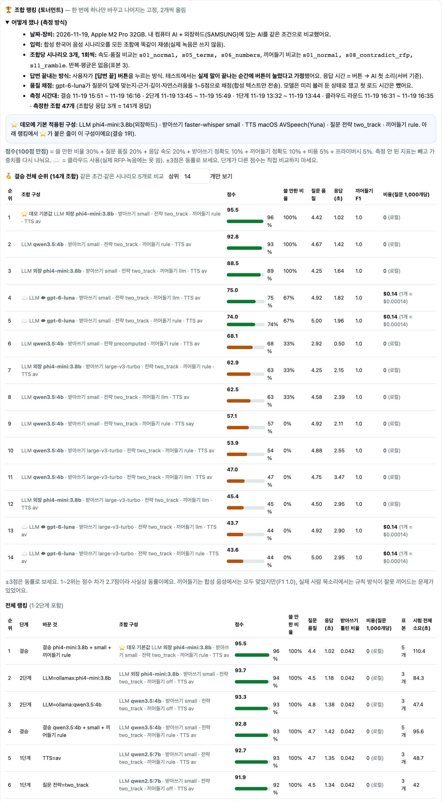
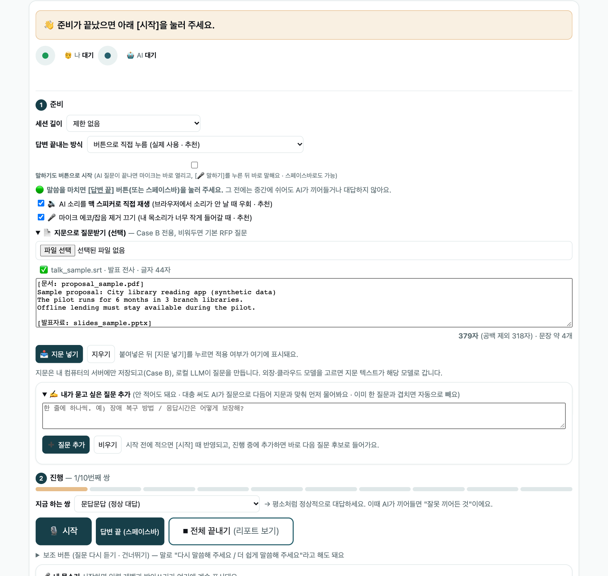
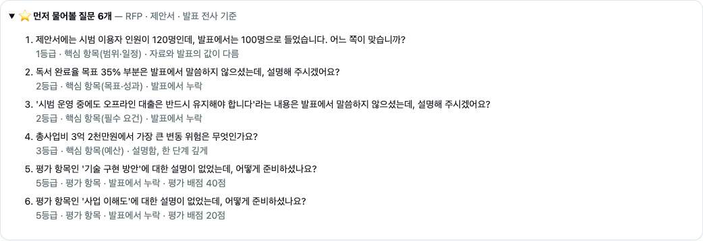
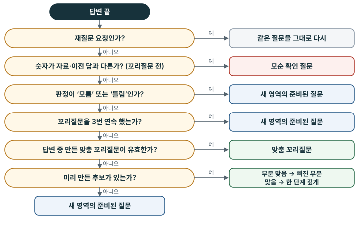
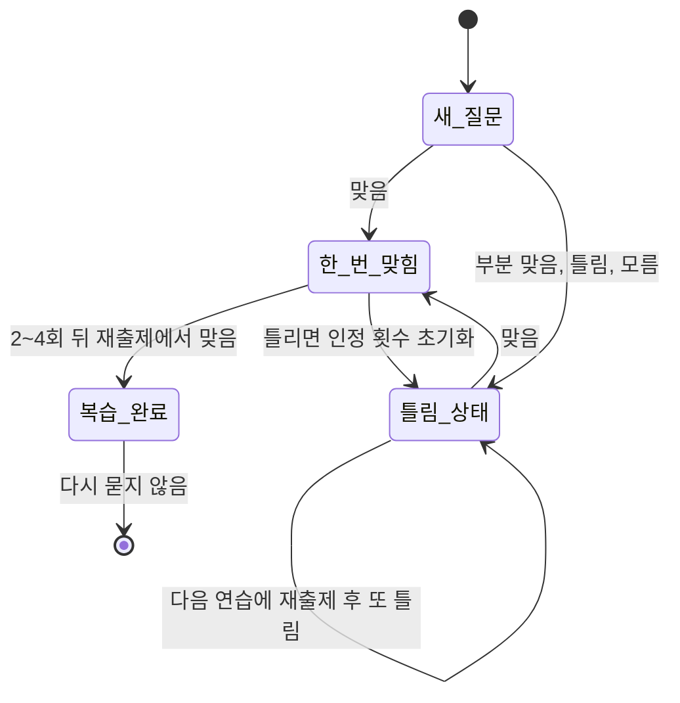

# Real-time Mock Interview: 실시간 음성 모의 면접

[English](README.md) | **한국어**

제안서, RFP, 발표자료를 바탕으로 AI 심사위원과 음성 질의응답을 연습하는 시스템입니다. 사용자의 답변을 실시간으로 전사하면서 후속 질문을 준비하고, 수치 불일치나 주제 이탈이 감지되면 답변 도중 확인을 요청합니다. 세션 종료 후에는 질문별 평가, 모범 답안, 근거 문장, 응답 지연을 정리한 리포트를 제공합니다.

기본 실행 환경은 **음성 인식(STT) → 언어 모델(LLM) → 음성 합성(TTS)**으로 구성된 로컬 파이프라인입니다. 질문의 근거를 추적하면서 응답 지연을 줄이기 위해 질문 생성과 음성 합성을 선행하고, 최종 평가는 세션 종료 후 별도로 수행합니다.


> **문서 범위**
> 각 기능의 요구사항, 대안 비교, 채택 근거, 구현 방식과 검증 한계를 설명합니다. 현재 코드의 동작과 과거 실험 결과를 구분하며, 소규모 실험에서 얻은 수치는 해당 조건에서의 관찰값으로 제시합니다.

---

## 목차

1. [핵심 설계 원칙](#1-핵심-설계-원칙)
2. [전체 구조](#2-전체-구조)
3. [모델과 구성 선정](#3-모델과-구성-선정)
4. [자료 입력과 텍스트 추출](#4-자료-입력과-텍스트-추출)
5. [첫 질문과 질문 후보 관리](#5-첫-질문과-질문-후보-관리)
6. [질문 품질 관리](#6-질문-품질-관리)
7. [질문 우선순위](#7-질문-우선순위)
8. [후속 질문](#8-후속-질문)
9. [답변 중 개입](#9-답변-중-개입)
10. [답변 턴과 음성 처리](#10-답변-턴과-음성-처리)
11. [재질문 요청과 사용자 질문 추가](#11-재질문-요청과-사용자-질문-추가)
12. [세션 시간 제한](#12-세션-시간-제한)
13. [리포트, 채점, 출처 검색](#13-리포트-채점-출처-검색)
14. [누적 복습 기록](#14-누적-복습-기록)
15. [지연과 발열 최적화](#15-지연과-발열-최적화)
16. [개인정보와 보안](#16-개인정보와-보안)
17. [설치와 실행](#17-설치와-실행)
18. [검증 범위, 한계, 다음 과제](#18-검증-범위-한계-다음-과제)

---

## 1. 핵심 설계 원칙

| 원칙 | 의미 | 코드에 반영한 방식 |
|---|---|---|
| **속도 우선** | 자연스러운 턴 전환을 위해 답변 종료 후 첫 음성 응답까지 2초 이내를 목표로 합니다. | 답변 중 다음 질문과 음성을 준비하고, 채점과 모범 답안 생성은 실시간 처리 경로에서 분리합니다. |
| **근거 기반** | 입력 자료를 질문 생성의 근거로 사용합니다. | 질문별 근거 문장을 저장하고, 자료의 구체적인 내용을 묻지 않는 일반 질문을 필터링합니다. |
| **단일 논점** | 복수 논점을 포함한 질문은 답변 범위와 평가 기준을 불명확하게 만듭니다. | 프롬프트와 규칙 기반 문장 검사를 함께 적용합니다. |
| **중복 질문 억제** | 반복 질문을 줄여 한정된 시간에 다양한 항목을 연습하도록 합니다. | 일반 질문과 후속 질문, 개입 문장을 기존 질문 이력과 비교합니다. |
| **로컬 우선** | 제안서와 음성 데이터의 외부 전송을 최소화합니다. | 기본 구성은 입력 데이터를 로컬에서 처리하며, 클라우드 모델은 선택한 경우에만 사용합니다. |
| **단일 변수 비교** | 구성 변경에 따른 효과를 구분할 수 있도록 비교 조건을 통제합니다. | 모델은 단계별 토너먼트로 선정하고, 지연 최적화는 단일 변수 실험으로 검토했습니다. |

---

## 2. 전체 구조


### 실행 방식(Case) 비교

음성 처리와 전송 구조에 따른 차이를 확인하기 위해 세 가지 실행 방식을 비교했습니다. Case A와 B는 로컬 질문 엔진을 사용하며, Case C는 OpenAI Realtime이 음성 응답을 생성하는 비교 구성입니다.

| Case | 구성 | 첫 음성 응답 지연 P50 (합성 음성 3개) | 장점 | 제약 |
|---|---|---|---|---|
| **B (채택)** | VAD → faster-whisper → 로컬 LLM → 로컬 TTS | 2.00초 | 질문 선택과 검증을 애플리케이션에서 관리하며, 입력 데이터를 로컬에서 처리합니다. | 장비 성능의 영향을 받습니다. |
| A | B와 같은 처리 + LiveKit(WebRTC) 전송 | 2.14초 | 실시간 통신 표준을 사용합니다. | 루프백 환경에서만 검증했으며, 브라우저 UI는 구현하지 않았습니다. |
| C | OpenAI Realtime Speech-to-Speech | 1.26초 | 이 비교 실험에서 응답 지연이 가장 짧았습니다. | 모델이 질문을 직접 생성하므로 질문 통제가 제한되며, 음성 데이터가 외부로 전송됩니다. |
| D | Pipecat | 구현하지 않음 | — | — |

위 수치는 모델 선정과 지연 최적화 이전의 초기 비교 결과입니다. **Case B는 질문 통제, 근거 추적, 로컬 데이터 처리 요구사항을 고려해 채택했습니다.** 이후의 지연 최적화 결과는 [15절](#15-지연과-발열-최적화)에 별도로 정리했습니다.

---

## 3. 모델과 구성 선정

### 3.1 선정 방식: 토너먼트

전체 조합을 평가하면 실험 횟수가 수백 회로 늘어나고 장비 부하도 커집니다. 이를 줄이기 위해 **한 번에 하나의 구성 요소를 변경하고 나머지는 기준 구성으로 고정한 뒤, 상위 2개 후보를 다음 단계에서 조합하는** 토너먼트 방식을 사용했습니다.

| 단계 | 비교 요소 | 측정한 조합 |
|---|---|---|
| 1단계 | STT, TTS, 개입 정책, 질문 전략 | 14 |
| 2단계 | LLM(기본 Ollama 및 외장 저장소의 모델 구성) | 14 |
| 결승 | 상위 후보의 조합 | 14 |
| 클라우드 라운드 | 클라우드 LLM(별도 평가) | 5 |

- **장비:** Apple M2 Pro 32GB(Metal GPU)
- **입력:** 합성 한국어 음성. 모든 조합에 같은 파일을 재생했습니다. 클라우드 조합이 있으므로 실제 녹음은 사용하지 않았습니다.
- **표본:** 단계에 따라 시나리오 3~5개, 각 1회

### 3.2 점수 산출식

`점수 = 100 × Σ(지표 점수 × 가중치) ÷ Σ(측정한 지표의 가중치)`

| 지표 | 정의 | 가중치 |
|---|---|---|
| 속도 및 품질 동시 충족률 | 첫 음성 응답까지 2.0초 이내이면서 질문 품질이 3.5/5 이상인 시나리오 비율 | 30% |
| 질문 품질 | 평가 모델이 관련성, 근거, 깊이, 자연스러움을 1~5점으로 채점 | 20% |
| 응답 속도 | `답변 끝` 버튼부터 AI의 첫 음성 응답까지(1초 이하 만점, 3초 이상 0점) | 20% |
| 음성 인식 정확도 | 문자 오류율(Character Error Rate, CER) | 10% |
| 개입 정확도 | 정답 라벨이 있는 시나리오의 F1 | 10% |
| 비용 | 질문 1,000개당 클라우드 추정 비용 | 5% |
| 프라이버시 | 음성, 텍스트의 외부 전송 여부 | 5% |

응답 속도와 질문 품질을 함께 확보하도록 **속도 및 품질 동시 충족률**에 가장 높은 가중치를 부여했습니다. 실제로 미리 만든 질문만 읽는 `precomputed` 전략은 0.5초로 가장 빨랐지만 품질이 2.9점이어서 순위가 낮았습니다.

### 3.3 최종 후보 평가



전체 47개 조합의 순위는 [전체 랭킹 화면](docs/images/ranking_full.png)과 [docs/RANKING.md](docs/RANKING.md)에서 확인할 수 있습니다. 이 프로젝트에서는 점수 차이가 3점 이내인 구성을 실질적인 동률로 취급합니다. 이는 후보 선택을 위한 기준이며 통계적 동등성 검정 결과는 아닙니다.

> 랭킹 이미지의 "데모 기본 적용" 표시는 토너먼트 당시의 설정입니다. 이후 TTS를 변경했으므로 현재 기본 구성과 해당 평가 결과를 구분해야 합니다.

### 3.4 현재 데모 기본 구성

| 구성 요소 | 기본 설정 | 결정 근거 |
|---|---|---|
| LLM | `phi4-mini:3.8b` (Ollama) | 결승 1위(95.5점)였습니다. 2위 `qwen3.5:4b`(92.8점)와는 사실상 동률이며 응답이 더 빨랐습니다(1.02초 대 1.42초). |
| STT | `faster-whisper small` (MPS 초기화 시도, 실패 시 CPU `int8`로 전환) | `large-v3-turbo`는 실제 사람 음성에서 더 정확했지만 2초 이내 비율이 낮았습니다. |
| 질문 전략 | `two_track` | 실시간 경로에는 경량 판단을 배치하고, 별도 분석은 백그라운드에서 수행합니다. `direct`(4.7초), `hybrid`(4.5초)보다 응답 지연이 짧았습니다. |
| 개입 | `rule` | 합성 시험에서 세 정책의 F1이 같았고, 규칙 방식이 가장 빠르며 LLM 호출이 없습니다. |
| TTS | `Supertonic 3` 한국어 `F1` (ONNX, 로컬) | 토너먼트는 macOS AVSpeech로 진행했습니다. 이후 음성 품질을 비교해 기본값을 바꾸었으며, **Supertonic 구성은 토너먼트로 다시 채점하지 않았습니다.** |
| VAD | Silero VAD(기본 무음 기준 600ms) | 음성 활동 감지에 사용하며, 자동 모드에서는 종료 확인 단계를 추가합니다. 수동 모드의 최종 턴 종료는 버튼으로 확정합니다. |
| 턴 방식 | 버튼(`manual`) | [10절](#10-답변-턴과-음성-처리) 참고 |

> 위 값은 `/v2` 화면의 기본 선택값입니다. WebSocket 주소에서 값을 생략하면 서버 기본값(`qwen2.5:7b`, 개입 `hybrid`)이 적용됩니다. 외부 화면을 연결할 때는 값을 명시해 주시기 바랍니다.

### 3.5 보조 실험과 설계 반영

| 실험 | 결과 | 설계 반영 |
|---|---|---|
| 실제 음성 3개의 전사 정확도 | CER: base 0.164, small 0.165, turbo 0.111 | 이 표본에서는 turbo의 CER가 가장 낮았으나, 기본 구성은 응답 지연을 고려해 선정했습니다. |
| 무음 길이 기반 종료 감지 | 침묵 기준 0.6초에서 답변당 평균 종료 감지 3.7회, 2.0초에서 1.0회 | 수동 답변 종료를 기본 모드로 채택했습니다. |
| LLM 동시 실행 중 음성 전사 | 평균 0.53초 → 1.05초 | 답변이 끝나면 백그라운드 LLM 작업을 멈춥니다. |
| 평가 모델 신뢰도 | 기준 평가 모델과의 상관: 로컬 0.54~0.61, 저가 클라우드 0.79 | 로컬 모델의 점수는 절대값이 아닌 참고 순위로만 해석합니다. |

자세한 방법과 한계는 [docs/MINI_SUITE.md](docs/MINI_SUITE.md)에 있습니다.

---

## 4. 자료 입력과 텍스트 추출

입력 자료는 **RFP, 제안서, 발표자료, 발표 전사**로 구분합니다. 문서 원문은 질문과 평가의 근거로 사용하고, 발표 전사는 문서 내용과의 비교에 활용합니다. 지원 형식별 추출기를 통해 텍스트를 추출하고, 문서 유형을 나타내는 헤더와 함께 입력 본문에 추가합니다.

| 형식 | 처리 방식 |
|---|---|
| PDF | `pypdf`로 읽고, 텍스트가 거의 추출되지 않으면 `pdftotext`(설치된 경우)로 다시 시도합니다. |
| PPTX | 슬라이드별 텍스트, 표, 그룹 도형, 발표자 노트를 읽습니다. |
| DOCX, XLSX | 문단과 표, 시트별 행을 읽습니다. |
| DOC, RTF | macOS `textutil`로 변환합니다. |
| HTML | 스크립트와 태그를 제거합니다. |
| SRT, VTT | 번호와 시간 표시를 지우고, 반복된 자막은 한 번만 남깁니다. |
| JSON | Whisper 형식의 `segments`를 이어 붙입니다. |
| TXT, MD, CSV | UTF-8, UTF-16, CP949, EUC-KR 순서로 해석합니다. |

- **파일 형식 판별:** 파일 이름보다 **내용(바이트 서명)** 을 먼저 확인합니다.
- **미지원 형식:** 스캔 PDF와 이미지(OCR 미연결), 구형 `.ppt`, `.hwp`는 저장 형식을 바꾸라는 안내를 보여 줍니다.
- **크기 제한:** 파일은 60MB, 지문은 150,000자까지입니다. 업로드한 파일 자체는 저장하지 않습니다.



*위 화면의 파일은 설명용으로 만든 합성 자료입니다.*

---

## 5. 첫 질문과 질문 후보 관리

### 5.1 긴 문서의 전처리와 참조 범위

초기 구현은 입력 본문을 30,000자로 제한하고 근거 검색에 14개 문장 표본을 사용했습니다. 현재는 긴 자료의 참조 범위를 확대하되, 모델 입력은 필요한 구간으로 제한합니다.

- 입력 본문 상한을 **150,000자**로 늘렸습니다.
- **전처리 후 최대 1,500개 문장**을 근거 검색, 수치 모순 검사, 다음 주제 선택에 사용합니다. 이 한도를 넘는 문서는 전체 구간에서 균등하게 표본을 선택합니다. 합성 지문(5만 자, 600문장)에서 근거 문장 검색은 1ms였습니다.
- 기본 질문 생성에서는 문서 전체 대신 선택한 문장이나 제한된 구간을 모델에 전달합니다.
- 붙여 넣은 웹 문서의 시각 표시, 분류 목록, 표 잔여물, `[음악]` 같은 자막 표시는 먼저 제거합니다.

### 5.2 첫 질문

세션 시작 지연을 줄이기 위해 첫 질문은 **문서 앞부분의 완결된 문장 약 700자**를 기준으로 생성합니다.

1. 자료 입력 시 백그라운드에서 질문을 준비합니다. 사용 가능한 질문이 있으면 해당 질문을 대기열에 반영합니다.
2. 대기열이 비어 있으면 문서 앞부분을 바탕으로 첫 질문을 즉시 생성합니다. 생성은 최대 2회 시도합니다.
3. 생성에 실패하거나 범용적인 질문이 반환되면, 본문에서 추출한 용어를 넣은 **"○○의 근거나 수치를 말씀해 주시겠어요?"** 형식의 대체 질문을 사용합니다. 유효한 용어도 추출하지 못하면 제안서의 수치나 기간에 대한 근거를 요청합니다.

> **결정 배경:** "이 글의 핵심 내용을 본인의 말로 설명해 주시겠어요?"처럼 어느 문서에나 쓸 수 있는 질문은 제안서 코칭에 맞지 않습니다. 따라서 프롬프트, 품질 필터, 대체 질문, 복습 기록 로딩 단계에서 이러한 범용 표현을 제한합니다.

### 5.3 질문 후보 생성과 보충

| 항목 | 값 |
|---|---|
| 라운드별 목표 생성량 | **3개** |
| 보충 시점 | 아직 묻지 않은 질문이 **1개 이하** |
| 생성 단위 | 후보 문장당 모델 호출 1회. 품질 필터 탈락 시 다른 문장으로 재시도하며, 일반 후보 생성 루프는 목표 질문 수의 최대 4배까지 호출 |
| 문장 선택 | 최대 120개 문장 표본을 초반, 중반, 후반으로 나누고, 각 구간에서 기존에 사용하거나 시도한 문장과 가장 떨어진 위치를 선택 |
| 우선권 | 답변 처리 중에는 백그라운드 생성을 중단해 실시간 요청에 추론 자원을 우선 배정 |

**생성 배치 크기 비교**

| 방식 | 라운드 처리 | 첫 라운드 소요 | 14개 생성 시 CPU 시간 |
|---|---|---|---|
| 처음에 질문 14개, 모범 답안, 후속 후보를 일괄 생성 | LLM 약 43회 호출, 높은 처리 부하 | — | — |
| 7개씩, 2개 남으면 보충 | 6.4~8.5초 | 8.5초 | 약 15초 |
| **3개씩, 1개 남으면 보충 (채택)** | 약 1.8초 | 1.9초 | 약 8.4초 |

당시 실험에서는 질문 하나당 평균 약 35초가 소요되어, 3개씩 보충하는 방식으로도 다음 질문을 준비할 수 있었습니다. 초기 생성량을 줄이면서 사용되지 않는 질문도 감소했습니다. 다만 표의 수치는 품질 필터 강화 이전의 측정값이며, 강화 이후에는 한 라운드에 5~8초가 소요된 사례가 있습니다.

---

## 6. 질문 품질 관리

소형 로컬 모델은 프롬프트에 명시한 제약을 일관되게 준수하지 못했습니다. 규칙을 추가해도 통과율이 개선되지 않아, 생성 프롬프트를 간결하게 유지하고 **규칙 기반 후처리로 질문의 형식과 근거를 검증**하도록 구성했습니다. 아래 검사는 질문 후보 풀과 맞춤 후속 질문을 중심으로 적용되며, 첫 질문이나 고정 템플릿 등 모든 생성 경로에 동일하게 적용되는 것은 아닙니다.

| 검사 | 검사 기준과 제외 대상 |
|---|---|
| 단일 논점 | 55자 초과, "~이해하고 있나요?" 같은 확인형, 복수 대상의 중첩 연결, 요청 두 개, 물음표 두 개, "~인지, ~"처럼 쉼표로 이은 이중 질문 |
| 문장 복잡도 | 수식어와 "~의"가 겹친 문장, "~의"의 연속 |
| 문체 | "~냐고", "~지냐", "~아니냐" 같은 반말투, 존댓말 의문형이 아닌 끝맺음 |
| 일반 질문 | "핵심 내용", "본인의 말로", "이 글의" |
| 맥락 없는 지시어 | "이 문장", "이 그림", "그 부분"처럼 듣는 사람이 알 수 없는 대상. 대상이 문장 안에 있으면 지시어만 제거합니다. |
| 문서 잔여물 | 날짜, 시각, 편집 표시, 영상 제목 조각, 한자, 일본어 혼입 |
| 근거 확인 | 질문의 핵심어가 출처 문장에 있어야 합니다. "이유"를 물으려면 문장에 이유 표현이 있어야 합니다. |
| 중복 표현 | "통화 기능과 통화 기능의…"처럼 같은 말이 반복된 문장 |
| 중복 | 지금까지 한 모든 질문과 문장 유사도 및 핵심어 겹침 비교 |

엄격한 근거 기준을 충족하지 못하더라도 완화된 근거 기준과 단일 논점 검사를 통과한 질문은 **예비 목록**에 보관합니다. 정규 후보가 부족할 때만 예비 후보를 사용하며, 중복 여부를 다시 확인합니다.

> **남은 한계:** 필터는 부적절한 출력을 제외하는 장치이므로 모델 자체의 한국어 생성 능력을 개선하지는 않습니다. 기준을 강화할수록 유효 후보가 줄어들어 질문 보충 시간과 응답 지연이 증가할 수 있습니다.

---

## 7. 질문 우선순위

자료의 핵심 항목과 발표 내용을 비교해 질문 우선순위를 결정합니다. **점수는 명시적인 규칙으로 계산**하여 처리 비용을 낮추고, 각 질문이 우선 배정된 이유를 함께 기록합니다. 모델은 선택적으로 차별점 문장을 식별하는 보조 역할만 수행합니다.



*위 화면의 자료는 설명용 합성 데이터입니다.*

### 7.1 검토한 선택지

| 방식 | 판단 |
|---|---|
| 생성 순서 (이전 방식) | 중요한 내용을 먼저 묻는다는 보장이 없었습니다. |
| LLM의 문장별 중요도 평가(0~1점) | 추가 모델 호출에 따른 지연과 부하, 소형 모델의 평가 일관성을 고려해 채택하지 않았습니다. 규칙 방식과의 순위 정확도 비교는 수행하지 않았습니다. |
| **규칙 기반 평가 + 선택적 모델 보조 (채택)** | 수치 비교와 배점 반영은 규칙으로 처리합니다. 모델은 기존 문장의 번호를 선택하는 데만 사용하고, 선택 결과를 원문에 매핑해 새로운 내용을 근거로 추가하지 않도록 제한합니다. |

### 7.2 자료 구분

자료별 헤더가 있으면 문서 유형을 구분해 우선 질문을 구성합니다. 파일 업로드 시 헤더가 자동으로 추가되며, 사용자가 직접 수정할 수 있습니다.

`[RFP: 이름]`, `[제안서: 이름]`, `[발표자료: 이름]`, `[발표 전사: 이름]`

- **참조 문서가 함께 있으면 발표 전사를 질문과 평가의 근거에서 제외**하고 비교에 사용합니다. 다만 전사만 입력한 경우에는 `reference_text()`가 전사를 참조 본문으로 반환합니다. 따라서 전사의 근거 사용을 항상 차단하는 구조는 아닙니다.
- 문서 구분 헤더가 없는 일반 본문에는 우선 질문 계획을 적용하지 않고, 기본 질문 생성 경로를 사용합니다.

### 7.3 핵심 항목

예산, 목표, 필수 요건 등 핵심 항목은 누락이나 불일치가 없더라도 질문 대상으로 선정합니다. 이미 근거를 설명한 항목에는 심화 질문을 배정합니다.

| 분류 | 찾는 단서 |
|---|---|
| 예산 | 예산, 사업비, 비용, 인건비, 금액 표현 |
| 필수 요건 | 필수, 반드시, 의무, 준수, "~해야 한다" |
| 목표 및 성과 | 목표, 성과, 지표, 달성, 향상 |
| 차별점 | 차별, 핵심 전략, 강점 + (선택) 모델이 고른 문장 |
| 수행체계 | 추진 체계, 조직, 투입 인력, 참여 기관 |
| 범위 및 일정 | 대상, 인원, 기간, 일정 |

분류별로 최대 2개 항목을 선정합니다. 수치 포함 여부, 평가 배점, 여러 문서 유형에서의 반복 여부를 순서대로 고려합니다.

**평가 배점**은 평가 항목이나 배점 표시가 포함된 참조 문서에서 추출합니다. `사업 이해도 20점`, `수행 능력 | 30`과 같은 행 형식을 인식합니다.

### 7.4 등급과 점수

| 등급 | 조건 | 기본 점수 |
|---|---|---|
| 1 | 핵심 항목의 값이 **문서와 발표 또는 문서 간에 불일치** | `0.975` |
| 2 | 핵심 항목이 **발표에서 누락되었거나 근거가 부족함** | `0.965` |
| 3 | 핵심 항목을 **근거까지 설명됨**: 심화 질문 배정 | `0.955` |
| 4 | 일반 수치의 불일치 | `0.945` |
| 5 | 평가 항목이 발표에서 누락됨 | `0.935` |
| 6 | 평가 항목을 언급했으나 근거가 없음 | `0.925` |

- **점수 = 기본 점수 + 배점 × 0.00008.** 배점이 100점이어도 가산값은 0.008이므로 등급 간격(0.01)을 넘지 못합니다. 배점은 **같은 등급 안의 순서**만 바꿉니다.
- 우선 질문은 최대 10개입니다. 핵심 항목에 높은 등급을 부여해 제한된 질문 수 안에서 우선 배정합니다.
- 설명한 핵심 항목은 같은 내용을 되묻지 않습니다. 예를 들어 예산을 설명했다면 *"가장 큰 변동 위험은 무엇인가요?"* 처럼 묻습니다.
- 발표 전사가 없으면 핵심 항목의 근거를 묻습니다.
- 전사 오류 가능성이 있으므로 발표와의 불일치는 *"발표에서는 100명으로 들었습니다. 어느 쪽이 맞습니까?"* 처럼 **확인형 질문**을 사용합니다.
- 금액은 값으로 비교합니다. `1,200만원`과 `12,000,000원`은 같은 값입니다.

### 7.5 연습 중 갱신

답변 종료 시 대기 중인 우선 질문을 다시 평가합니다. 앞선 답변에서 이미 설명한 내용은 다음 규칙에 따라 심화 질문으로 전환하거나 대기열에서 제외합니다.

| 대기 중인 질문 | 앞선 답변에서 근거까지 설명하면 |
|---|---|
| 핵심 항목의 근거 부족 또는 누락 (2등급) | 근거를 되묻지 않고 **심화 질문(3등급)** 으로 바꿉니다. |
| 평가 항목 (5, 6등급) | 대기열에서 제외합니다. |
| 값 불일치 (1, 4등급) | 추가 확인이 필요하므로 유지합니다. |

### 7.6 전체 질문 순서

| 질문 종류 | 점수 |
|---|---|
| 첫 질문 | `1.00` |
| 사용자가 추가한 질문 | `0.99 − 0.001 × 순번` |
| 복습: 지난번에 틀린 질문 | `0.985 − 0.001 × 순번` |
| **핵심 및 우선 질문** | `0.925 ~ 0.984` |
| 일반 질문 후보 풀 | 우선 질문이 있으면 `0.6 − 0.005 × 순번`, 없으면 `1.00 − 0.02 × 순번` |
| 복습: 한 번 정답 처리된 질문 | `0.3~0.9` 무작위 |
| 즉석 생성 | `0.4` |

- 점수는 백분율이 아니라 **묻는 순서를 정하는 값**입니다.
- 대기 중인 비슷한 질문은 하나로 합치며, 이때 더 높은 점수를 사용합니다.
- 후속 질문은 대기열을 거치지 않고 바로 이어집니다. 따라서 **후속 질문이 많으면 정해진 턴 안에서 우선 질문을 모두 묻지 못할 수 있습니다.**

### 7.7 한계

- 분류와 비교는 **키워드 기반 휴리스틱**입니다. 의미가 같아도 표현이 다르면 누락할 수 있으며, 관련성이 낮은 문장을 핵심 항목으로 선택할 수 있습니다.
- 값 불일치는 **같은 단위이고 핵심어가 2개 이상 겹칠 때**만 판정합니다. 오탐을 줄이기 위한 보수적인 기준입니다.
- 배점 추출은 위에 제시한 행 형식을 중심으로 지원하며, 임의의 표 구조를 해석하지는 못합니다.
- **합성 자료로만 검증했습니다.** 실제 RFP에서의 정확도, 그리고 사람이 매긴 순위와의 일치도는 아직 확인하지 않았습니다.
- 모델이 차별점 문장을 고르는 보조 기능의 **선택 정확도는 평가하지 않았습니다.** 실패해도 규칙 결과는 그대로 사용합니다.
- 발표 전사는 **파일(자막, 텍스트) 업로드**로 받습니다. 발표 중 실시간 전사를 연결하는 기능은 아직 없습니다.

---

## 8. 후속 질문

### 8.1 정의

후속 질문은 직전 답변에 등장한 내용과 자료의 근거를 연결해 설명을 구체화하거나 검증하는 질문입니다. 기존 질문의 단순 반복을 피하고, 근거가 없는 새로운 사실을 전제로 삼지 않도록 생성 조건을 제한합니다.

### 8.2 다음 질문의 결정 과정

<p align="center"></p>

**실시간 임시 판정**은 LLM 호출 없이 다음 질문의 방향을 결정합니다. 관련 근거 문장과 답변의 핵심어 중복을 다음 기준으로 분류합니다.

- "모르겠습니다"류의 짧은 답은 `모름`입니다.
- 답변과 관련 지문 문장의 핵심어가 4개 이상 겹치면 `맞음`, 2개 이상이면 `부분 맞음`, 그보다 적으면 `틀림`입니다.

이 결과는 다음 대화 행동을 선택하기 위한 **임시 분류**이며, 답변의 의미적 정확성을 검증한 점수가 아닙니다. 리포트의 최종 평가는 세션 종료 후 LLM이 별도로 수행합니다([13절](#13-리포트-채점-출처-검색)).

> **결정 배경:** 오답이나 응답 불가로 분류된 주제를 계속 확장하면 유효한 연습 기회가 줄어들 수 있어, 기본적으로 다른 주제로 전환합니다.

### 8.3 답변 기반 후속 질문의 선행 생성

답변 종료 후 후속 질문 생성을 시작하면 목표 지연인 2초를 초과할 수 있습니다. 이를 줄이기 위해 **발화 중 확보한 부분 전사**를 바탕으로 후보를 선행 생성하고, 최종 답변과의 일관성을 확인한 뒤 사용합니다.

**1. 생성 시작 조건**

- 부분 전사가 **15자 이상**입니다. (처음에는 40자였고, 15자로 낮춘 뒤 준비 시점이 10.2초에서 6.0초로 빨라졌습니다.)
- 미사용 질문이 1개 이하인 보충 우선 상태가 아니어야 합니다.
- 최초 생성이거나, 직전 후보 생성 시점보다 전사 내용이 40자 이상 증가해야 합니다.

**2. 근거 문장 검색** — 다음 조건을 모두 만족하는 지문 문장을 찾습니다.

- 답변의 단어가 **질문에는 없던 새 단어**입니다.
- 그 단어가 지문의 **2개 이하 문장**에만 나오는 희귀한 단어입니다.
- 후속 질문에 **이미 사용한 문장이 아닙니다.**
- 영문, 숫자 용어이거나, 일반 한글 단어는 2개 이상 겹쳐야 합니다.

**이 경로에서는 근거 문장을 확보한 경우에만 답변 기반 후속 질문을 생성합니다.**

**3. 질문 유형 선택** — 위에서부터 조건을 확인하며, 직전과 같은 유형은 피합니다.

| 유형 | 조건 |
|---|---|
| 더 자세히 | 새 용어를 말한 부분이 짧습니다. |
| 검증 | 지문 문장에 측정, 검증, 확인, 기준 표현이 있는데 답변에는 없습니다. |
| 근거 | 지문 문장에 이유, 필요 표현이 있는데 답변에는 없습니다. |
| 순서 | 지문의 3단계 이상 절차에서 답변이 중간 단계를 건너뛰었거나 앞에서 멈췄습니다. 고정 틀을 사용하므로 LLM 호출이 없습니다. |
| 더 깊이 | 근거 문장은 있지만 위 조건에 해당하지 않을 때의 마지막 선택입니다. |

**4. 후보 검증**

- 기본 길이 검사는 8~110자이며, 단일 논점 검사(`one_thing`)가 추가로 적용되므로 해당 경로의 실질적인 상한은 55자입니다.
- 존댓말 의문문으로 끝납니다.
- 이미 한 질문과 비슷하지 않습니다.
- 답변에서 그대로 복사한 구간이 질문의 60%를 초과하지 않습니다.
- **답변에서 새로 나온 용어를 포함합니다.**

**5. 최종 답변과의 일관성 확인** — 생성 시점의 핵심어 중 60% 이상이 최종 답변에도 남아 있어야 후보를 사용합니다. 완료되지 않은 생성 작업은 답변 종료 시 취소해 STT와의 자원 경합을 줄입니다. 보조 실험에서는 LLM 동시 실행 시 STT 처리 시간이 약 2배 증가했습니다.

### 8.4 사전 생성 후보

현재 질문을 제시한 뒤 근거 문장을 바탕으로 **심화 질문(`deeper`)과 누락 확인 질문(`gap`)**을 미리 생성합니다. 답변에 맞춘 후속 질문을 확보하지 못하면, 임시 판정과 중복 검사를 거쳐 사전 생성 후보를 사용합니다.

### 8.5 연속 횟수와 연결 문구

- 한 질문에서 연속 후속 질문은 **최대 3회**입니다. 이는 대화 깊이와 주제 전환의 균형을 위한 설계값이며, 검증된 연구 표준으로 제시하지 않습니다.
- 갑작스럽게 들리지 않도록 *"답변 잘 들었습니다. ○○ 부분의 근거를 여쭤볼게요."* 같은 짧은 연결 문구를 붙입니다. 두 번째부터는 *"좋습니다. 이어서 하나만 더 여쭤볼게요."* 를 사용합니다.
- 연결 문구는 음성 사전 합성의 우선 대상으로 배정합니다.
- 후속 질문의 **지문 출처 문장은 그대로 저장**하며, 미리 만든 후보는 부모 질문의 출처를 물려받습니다.
- 리포트에는 후속 질문의 생성 또는 생략 사유를 기록합니다.

> **측정 결과:** 합성 답변 시험에서 답변 기반 후속 질문의 통과가 10회 중 1회에서 20회 중 8~9회(40~45%)로 늘었고, 작성 시간 중앙값은 1.2초에서 0.8초로 줄었습니다. *이 값은 최근의 "한 가지만 묻기" 강화(55자 제한 등) 이전에 잰 것입니다.*

---

## 9. 답변 중 개입

기본 런타임은 **3초 간격으로 최근 14초 분량의 부분 전사**를 검사합니다. 개입 판단은 발화 시작 후 최소 3초가 지난 시점부터 적용하며, 아래 조건에 따라 확인이나 방향 전환을 요청합니다.

| 상황 | 기본 규칙(`rule`) |
|---|---|
| 문서와의 수치 불일치 | 단위가 같고 핵심어가 2개 이상 일치하지만, 수치가 문서의 값 또는 허용 조건과 다릅니다. |
| 이전 답변과의 수치 불일치 | 같은 단위의 다른 값이며 핵심어가 3개 이상 겹칩니다. |
| 반복 발화 | 3어절 묶음의 반복 비율이 30%를 넘습니다. |
| 주제 이탈 | 발화가 8초를 초과하고 전사 길이가 60자를 초과하며, 질문 핵심어와의 중복률이 20% 미만입니다. |
| 지나치게 긴 답변 | 75초를 넘습니다. |

- **응답 형식:** 정중한 도입, 개입 이유, 답변 재개 요청으로 구성된 고정 템플릿을 사용합니다. 개입 문장 생성에는 LLM을 호출하지 않으며, 음성은 사전에 합성합니다.
- **반복 방지:** 이미 사용한 문장은 다시 말하지 않습니다.
- **개입 이후 상태 갱신:** 개입 이후의 발화만 새 판단 대상으로 사용합니다.
- **다른 정책:** `llm`(모델 판단)과 `hybrid`(규칙으로 감지한 뒤 모델로 확인하되, 수치 모순은 모델 확인 없이 처리)를 선택할 수 있습니다.

**개입 원칙:** 지속적인 주제 이탈에는 답변 방향을 안내하고, 모호한 답변에는 후속 질문으로 설명을 요청하도록 설계했습니다. 사실 검증은 현재 **수치 불일치 규칙**에 한정하며, 일반적인 사실의 진위를 판별하는 기능은 구현하지 않았습니다.

> **검증 한계:** 위 기준값(3초, 20%, 30%, 60자, 75초 등)은 연구로 검증된 기준이 아닌 **초기 설정값**입니다. "주제 이탈" 글자 수는 14초 검사 창에서 보통 말하기 속도로 약 75~93자만 담긴다는 계산에 따라 90자에서 60자로 낮췄습니다. 합성 시험에서는 F1이 1.0이었지만, 실제 사람 음성에서는 규칙 방식이 정상 답변을 주제 이탈로 오판한 사례가 많았습니다(초기 시험 9회 중 7회). 이후 연습 기록으로 조정했으나 **실제 음성에서의 충분한 검증은 아직 필요합니다.**

---

## 10. 답변 턴과 음성 처리

### 10.1 답변 종료 감지

| 검토한 방식 | 결과 |
|---|---|
| 무음 길이 | 임계값이 짧으면 발화 중간에 종료로 오인하고, 길면 턴 전환이 지연됩니다. |
| 무음 + 종결 표현 | 답변이 이어지는 중에도 종결 표현이 등장해, 해당 실험에서는 0.6초 무음 기준보다 종료 감지 결과가 악화되었습니다. |
| 선행 생성 + 1.5초 종료 확인 | 해당 실험에서 답변당 중단 횟수가 2.7회에서 1.3회로 감소했습니다. |
| **수동 턴 종료 (채택)** | 사용자가 종료 시점을 확정하므로, 무음을 답변 종료로 오인하는 문제를 줄입니다. 규칙 기반 개입은 별도로 동작합니다. |

수동 모드에서도 발화 중간의 무음 구간마다 전사를 진행합니다. 따라서 종료 버튼을 누른 뒤에는 아직 처리하지 않은 구간만 전사하여 후속 응답의 대기 시간을 줄입니다.

### 10.2 화면 조작

- 핵심 버튼은 **시작, 답변 끝(스페이스), 전체 끝내기** 3개입니다.
- 질문 다시 듣기와 건너뛰기는 보조 버튼입니다. 건너뛰기는 준비된 질문을 즉시 사용하고, 없으면 4초 제한으로 생성을 시도합니다.
- 원하면 **말하기 버튼(push-to-talk)** 도 켤 수 있습니다.

### 10.3 음성 전사 안정화

| 문제 | 대응 |
|---|---|
| 잡음 구간에서 입력한 용어 힌트가 전사 결과에 포함됩니다. | 힌트를 문장 형식으로 제공하고, 힌트가 반복 출력된 구간을 제거합니다. |
| 무음에서 "…뉴스 기자입니다" 같은 환각이 생깁니다. | 알려진 환각 문구를 제거합니다. |
| 같은 글자가 길게 반복됩니다. | 비정상 반복을 제거합니다. |
| "네" 같은 한 글자 답변이 버려집니다. | 실제 답변인 한 음절은 허용합니다. |
| 말을 마치자마자 버튼을 누르면 다음 답변이 "말씀하신 내용이 없습니다"로 거절됩니다. | 버튼으로 턴을 끝낼 때 음성 감지기(VAD) 상태를 초기화합니다. |
| 전문 용어를 틀리게 인식합니다. | 지문의 영문 용어를 음성 전사 힌트로 전달합니다. |

### 10.4 음성 합성

- 자주 쓰는 문장(다음 질문, 후속 질문 후보, 개입 문장, 연결 문구)은 **미리 합성해 저장**합니다.
- 첫 오디오 청크는 쉼표나 약 14자 지점에서 우선 전송해 초기 대기 시간을 줄입니다.
- 한국어 음성의 억양을 유지하기 위해 **TTS 입력에서만** 영어 용어를 한글 발음으로 변환합니다. 화면에는 원문을 표시합니다.

---

## 11. 재질문 요청과 사용자 질문 추가

### 11.1 "다시 말씀해 주세요"

사용자가 질문을 다시 요청하면 현재 질문을 재생합니다. 요청 의도가 반복 청취인지 쉬운 설명인지와 관계없이 질문 원문을 유지합니다.

| 요청 | 동작 |
|---|---|
| "다시 말씀해 주세요", "너무 빨라요" | 같은 질문을 **그대로** 다시 말합니다. |
| "더 쉽게 말씀해 주세요", "무슨 뜻인가요" | **쉽게 바꾸지 않고** 같은 질문을 그대로 다시 말합니다. |

> **설계 근거:** 질문을 쉽게 재작성하는 방식도 검토했으나, 재질문 과정에서 난이도나 평가 범위가 달라지는 것을 피하기 위해 원문을 유지하도록 결정했습니다. 따라서 재질문은 설명이나 힌트 제공이 아닌 동일 질문의 재생으로 처리합니다.

- 규칙으로 감지하며 LLM 호출이 없습니다. 60자 이상의 긴 답변에 이런 단어가 섞인 경우는 요청으로 보지 않습니다.
- 요청한 턴은 **답변이 아니므로 채점하지 않으며**, 리포트에 따로 표시합니다.

### 11.2 사용자 지정 질문

- 키워드나 미완성 문장을 입력하면 **지문에 맞춘 질문 한 문장**으로 다듬습니다. (최대 10개)
- LLM을 이용한 문장 변환은 **세션 준비 단계에서 질문을 등록할 때** 수행합니다. 세션 시작 시에는 변환된 질문을 사용하고, 진행 중 추가된 질문은 고정 템플릿으로 처리해 별도 LLM 호출을 피합니다.
- 진행 중에 추가한 키워드는 *"○○에 대해 제안서의 근거를 말씀해 주시겠어요?"* 형태로 즉시 바꿉니다.
- 기존 질문과 중복되면 제외하고, 대기열에 유사한 질문이 있으면 해당 질문을 **사용자 지정 질문**으로 변경합니다.
- 리포트에는 사용자 지정 여부, 우선순위 점수, 입력 원문을 함께 표시합니다.

---

## 12. 세션 시간 제한

세션 길이는 **10분, 20분, 30분 또는 제한 없음**으로 설정할 수 있습니다. 제한 시간은 첫 질문이 시작되는 시점부터 계산합니다.

| 시간이 끝난 시점 | 동작 |
|---|---|
| 사용자가 말하는 중 | **끝까지 듣고** 마무리합니다. |
| 답변을 처리하는 중 | 새 질문 대신 마무리 멘트를 합니다. |
| AI가 질문하는 중 | 질문을 마친 뒤 답을 기다립니다. |
| 10초 동안 아무 말이 없음 | 마무리 멘트를 합니다. |

종료 시에는 *"네~ 여기까지 들었습니다. 오늘 발표 수고하셨습니다."*라는 안내를 재생하고, 약 5초 후 자동으로 리포트를 생성합니다.

> 현재 제한: 시간이 끝난 뒤 들은 **마지막 답변은 화면 대화 기록에는 남지만 리포트 집계에는 포함되지 않습니다.** 실제 마이크로 전체 시간을 진행하는 검증은 하지 않았고, 대기와 마무리 로직은 단위 테스트로 확인했습니다.

---

## 13. 리포트, 채점, 출처 검색

### 13.1 채점을 실시간에서 분리한 이유

초기 구현은 세션 중 채점과 모범 답안 생성을 병행했으나, 동일한 로컬 추론 자원을 공유하면서 **STT와 다음 질문의 처리 지연이 증가**했습니다. 이에 기본 데모의 실시간 경로에서는 최종 평가를 제외하고, 세션 종료 후 별도 작업으로 수행하도록 변경했습니다.

세션 중에는 질문과 답변의 대응 관계, 전사 결과, **질문 생성에 사용한 근거 문장**, 단계별 처리 시간을 저장합니다. 이 기록을 종료 후 평가와 리포트 생성에 재사용합니다.

### 13.2 근거 추적: 생성 시점의 출처 저장

| 방식 | 설명 |
|---|---|
| 키워드 검색 | 채점할 때 지문에서 비슷한 문장을 다시 찾습니다. |
| **생성 시점의 출처 저장 (채택)** | 질문을 **만드는 시점**에 근거 문장(최대 300자)을 함께 저장합니다. |

- 답변 6개를 비교한 실험의 평균 처리 시간은 1.68초와 1.55초였습니다. 표본이 작아 속도 우위를 일반화하기 어려우며, 해당 실험에서는 입력 길이보다 출력 생성 길이가 처리 시간에 더 큰 영향을 보였습니다.
- 채택한 이유는 **정확성**입니다. 키워드 검색은 관련 없는 문장을 기준으로 잡아 정상 답변을 `틀림`으로 채점한 사례가 있었습니다.
- 질문 후보 풀의 질문은 생성에 사용한 문장을, 후속 질문은 **맞춤 생성에 사용한 문장 또는 부모 질문의 출처**를 저장합니다.
- 질문에 저장된 문장이 없는 경우(즉석 생성 질문 등)에는 질문과 핵심어가 가장 많이 겹치는 문장 1개를 사용합니다. 느슨하게 관련된 문장까지 넣으면 채점 기준이 흐려지므로 **1개만** 사용합니다.
- 과거 리포트 재평가에서도 저장된 출처가 없으면 키워드 검색을 대체 경로로 사용합니다.

### 13.3 채점 방식

- 답변마다 LLM을 **1회** 호출해 `판정(맞음, 부분 맞음, 틀림)`, 이유 한 문장, 모범 답안을 함께 만듭니다. 응답 형식이 유효하지 않거나 모범 답안이 충분히 생성되지 않으면 모범 답안을 추가로 요청합니다.
- "모르겠습니다"와 같은 응답은 규칙으로 `모름`을 판정합니다. 다만 최종 리포트에서 모범 답안을 함께 생성하는 `grade_with()` 경로는 이러한 응답에도 LLM을 호출합니다.
- 채점은 **세션이 끝난 뒤 백그라운드**에서 진행하며, 리포트는 먼저 표시한 뒤 판정과 모범 답안을 하나씩 채웁니다. 완성된 결과는 저장하여 재조회 시 동일 답변에 대한 LLM 호출을 반복하지 않습니다. 측정값은 답변 하나당 1.5~2.4초입니다.
- 지문 전체를 모델에 넣지 않습니다. 질문, 답변(최대 600자), 출처 문장(최대 300자)만 전달합니다.

> **채점의 한계:** 정상 평가 결과는 3단계 범주형 라벨이며, 별도의 `모름` 상태를 포함합니다. 수치 점수는 아닙니다. 기준이 출처 문장 일부이므로 여러 문장에 걸친 답은 불리할 수 있습니다. 로컬 LLM의 채점은 기준 평가 모델과의 일치도가 낮으므로 참고용으로 해석해야 합니다.

### 13.4 리포트 구성

- 질문별 **출처 구분**(첫 질문, 지문 기반 질문, 사용자 지정 질문, 후속 질문 유형과 순번, 개입)과 우선순위 점수
- 우선 질문을 **먼저 물어본 이유**(예: 핵심 항목(예산), 설명함, 한 단계 깊게)
- 사용자 답변, 판정과 이유, 모범 답안
- 후속 질문이 이어지거나 이어지지 않은 이유
- 누적 복습 기록(몇 번째로 맞혔는지, 언제 틀렸는지)
- 단계별 지연(음성 전사, 질문 생성, 음성 합성)과 2초를 넘긴 턴, 당시 실행 중이던 작업
- 개입 횟수와 오탐, 유도 적중, 클라우드 사용 시 추정 비용
- 공유용 Markdown 요약

---

## 14. 누적 복습 기록

동일한 자료로 반복 연습할 때 최종 평가 이력을 누적해 복습 대상을 결정합니다. **오답은 다음 세션에 우선 배정하고, 정답은 간격을 두고 재확인**합니다.



- `맞음`만 정답으로 인정합니다. 판정은 **LLM 채점 결과만** 사용하며, 실시간 빠른 판정은 반영하지 않습니다.
- 중간에 오답 없이 두 번 정답으로 평가되면 복습 완료로 처리합니다. 오답이 발생하면 누적 정답 횟수를 초기화합니다.
- 세션당 복습 질문은 최대 8개이며, 이전 오답을 우선 배정합니다.
- 후속 질문, 개입, 재질문 요청은 누적하지 않습니다.
- 복습 질문을 대기열에 등록할 때는 저장된 질문과 모범 답안을 재사용하므로 **추가 생성 호출이 필요하지 않습니다.** 새 답변에 대한 최종 평가는 별도로 수행합니다.
- 이전 기록에 남아 있는 범용 표현의 질문은 복습 대상에서 제외합니다.

**저장 방식 비교** (같은 조건에서 측정)

| 방식 | 읽기 시간 |
|---|---|
| 과거 리포트 50개를 매번 읽기 | 16.4ms |
| **누적 JSON 파일 1개 (채택)** | 0.8ms |
| SQLite | 0.22ms |

세 방식 모두 읽기 시간이 초 단위의 LLM 호출보다 짧아, 구현과 운영이 단순한 JSON을 채택했습니다. 저장은 임시 파일 작성 후 원자적 교체로 처리합니다. 복습 완료 여부는 근거 문장의 해시로 우선 조회하며, 근거가 없는 기록에는 질문 문구와 유사도 비교를 사용합니다. 기록된 비교 실험에서 13건 조회 시간은 유사도 비교 16ms, 해시 기반 조회 0.014ms였습니다.

---

## 15. 지연과 발열 최적화

### 15.1 응답 지연을 줄인 방법

| 분류 | 방법 |
|---|---|
| **선행 생성** | 질문 후보 풀, 후속 질문 후보, 답변 중 맞춤 후속 질문, 음성 사전 합성 |
| **실시간 처리 축소** | 채점, 모범 답안 제거, 규칙 기반 빠른 판정, 고정 개입 문장 |
| **자원 우선순위 관리** | 답변 처리 중에는 백그라운드 LLM 작업과 음성 합성을 멈춤 |
| **초기화 지연 축소** | 지문 앞부분으로 첫 질문 생성, 시작 전 모델 미리 불러오기(`/api/prewarm`) |
| **턴 전환 최적화** | 수동 답변 종료, 발화 중 구간별 전사, 준비된 질문 후보가 있으면 즉시 선택 |

### 15.2 단일 변수 실험과 채택 기준

지연 개선안은 응답 시간 중앙값이 **8% 이상이면서 0.05초 이상 감소**할 때 채택했습니다. 부하 감소안은 Whisper 처리 시간이 **15% 이상 감소하고 응답 시간 중앙값의 증가가 0.05초 이하**인 경우를 기준으로 삼았습니다. 발열은 온도 센서로 직접 측정한 값이 아니라 Whisper 작업 시간을 대리 지표로 평가했으며, 실행별 편차가 큰 CPU 시간은 채택 판단에서 제외했습니다.

| 실험 | 결과 | 판정 |
|---|---|---|
| 부분 전사 간격 2초 → 4초 | Whisper 시간 51% 감소, 응답 중앙값 동일 | 채택 후, 개입 반응을 고려해 **최종 3초** |
| LLM 문맥 4096 → 2048 | 개선 폭이 기준 실행 간 편차보다 작음 | 기각 |
| 음성 전사 검사 창 14초 → 8초 | 개입 규칙이 요구하는 글자 수와 충돌 | 보류 |
| 후속 질문 시작 조건 40자 → 15자 | 준비 10.2초 → 6.0초, Whisper 부하 동일 | 채택 |
| 첫 음성 전사를 3초에 실행 | 준비는 빨라지지만 Whisper 59% 증가 | 보류 |

현재 코드의 개입 검사 간격은 3초입니다. 검사 주기의 절반에 전사 지연을 더한 추정식에서는 4초 간격 대비 평균 반응 시간이 약 2.4초에서 1.9초로 감소합니다. 비교 실험에서는 발화 시간당 Whisper 작업량이 약 29% 증가했습니다. 반응 시간 추정과 처리 부하 측정은 구분해 해석해야 합니다.

### 15.3 측정 결과와 해석

| 항목 | 값 | 조건 |
|---|---|---|
| 답변 종료 → 첫 음성 응답 중앙값 | 0.47~0.56초 | 합성 답변 5개, 서버 기준 |
| 첫 실제 음성 실험 평균 | 2.25초 (최대 5.53초) | 최적화 이전의 1회 실행 |
| 준비된 질문이 없어 즉석 생성한 경우 | 약 2~4초 | 미해결 구간 |

> **측정 범위:** 위 중앙값은 사전 생성한 질문과 음성을 사용할 수 있었던 조건의 서버 측 측정값입니다. 합성 음성과 소규모 표본을 사용했으며, 브라우저에서 실제로 재생되기까지의 지연은 포함하지 않습니다. 준비된 후보가 소진되면 즉석 생성으로 인해 2초 목표를 초과할 수 있습니다.

상세 기록: [docs/LATENCY_AB.md](docs/LATENCY_AB.md), [docs/LIVE_RUN_LOG.md](docs/LIVE_RUN_LOG.md)

---

## 16. 개인정보와 보안

- 기본 구성(Case B + Ollama + faster-whisper + Supertonic)은 **음성과 지문을 외부로 보내지 않습니다.**
- Case C, `openai:` LLM, OpenAI STT, TTS를 선택하면 음성 또는 텍스트가 **OpenAI로 전송됩니다.** 공개 자료나 합성 자료로만 사용해 주시기 바랍니다.
- 실험에서 클라우드는 합성 데이터에만 사용했고, 실제 녹음은 로컬에서만 처리했습니다.
- API 키는 환경 변수 또는 데모의 키 입력 기능으로 설정합니다. `/api/key`는 서버 로컬 `.env`에 키를 저장하고 파일 권한을 `0600`으로 설정한 뒤 프로세스 환경 변수에 반영합니다.
- 연습 기록(`data/`), 녹음, 모델 파일은 저장소에서 제외합니다. 로컬 연습 기록에는 **전사된 답변과 지문 원문**이 저장되므로 공유에 주의해 주시기 바랍니다.
- 기본 실행은 `127.0.0.1`에 바인딩되며 **인증 기능은 구현되어 있지 않습니다.** 외부 공개를 전제로 한 구성이 아니며, 운영 환경에는 세션별 인증과 데이터 보관 및 삭제 정책이 필요합니다. ([docs/SECURITY.md](docs/SECURITY.md))

---

## 17. 설치와 실행

기존 실행 검증 환경은 Apple Silicon macOS와 Python 3.12입니다. 저장소 루트에서 다음 명령을 실행합니다.

```bash
uv venv --python 3.12 .venv
```

```bash
uv pip install --python .venv/bin/python openai httpx pydantic fastapi "uvicorn[standard]" websockets numpy scipy pytest faster-whisper silero-vad torch soundfile supertonic pypdf python-pptx python-docx openpyxl python-multipart
```

```bash
ollama serve
```

```bash
ollama pull phi4-mini:3.8b
```

- **음성 모델:** Supertonic 3 모델 파일은 저장소에 포함하지 않습니다. `models/tts/supertonic-3/`에 두거나 `SUPERTONIC_DIR`로 위치를 지정해 주시기 바랍니다. macOS 음성(`macos-avspeech:Yuna`)을 사용하려면 `pyobjc-framework-AVFoundation`을 추가로 설치합니다.
- **환경 변수:** `OLLAMA_URL`(기본값 `http://localhost:11434`), `OPENAI_API_KEY`(클라우드 비교를 할 때만 필요)

```bash
.venv/bin/python -m qa_lab serve --port 8765
```

브라우저에서 [데모 화면](http://127.0.0.1:8765/v2)을 엽니다. 이전 UI는 `/` 경로에서 제공됩니다. 테스트는 다음 명령으로 실행합니다.

```bash
.venv/bin/python -m pytest -q tests
```

### 문제 해결

| 증상 | 확인할 것 |
|---|---|
| "질문 생성 중"에서 멈춤 | Ollama가 실행 중인지, 선택한 모델을 받았는지 확인합니다. |
| 첫 질문이 나오지 않음 | 서버 로그의 `ModuleNotFoundError`를 확인합니다. 선택한 TTS의 패키지와 모델 파일이 필요합니다. |
| AI 소리가 들리지 않음 | 화면의 스피커 테스트를 누르거나 "맥 스피커로 직접 재생"을 선택합니다. |

### 코드 구조

| 경로 | 역할 |
|---|---|
| `qa_lab/core/engine.py` | 질문 선택, 후속 질문 생성, 임시 판정, 최종 평가 |
| `qa_lab/core/passage.py` | 본문 전처리, 첫 질문 생성, 질문 후보 관리 |
| `qa_lab/core/planner.py` | 생성 프롬프트와 질문 품질 필터 |
| `qa_lab/core/question_queue.py` | 우선순위 대기열과 중복 제거 |
| `qa_lab/core/importance.py` | 자료 유형 구분, 핵심 항목 추출, 발표 전사 비교 |
| `qa_lab/core/quantities.py` | 금액, 수치, 단위 정규화 |
| `qa_lab/core/interjection.py` | 답변 중 개입 정책 |
| `qa_lab/core/clarify.py` | 재질문 요청 감지 |
| `qa_lab/core/user_questions.py` | 사용자 지정 질문 변환과 등록 |
| `qa_lab/core/ledger.py` | 누적 평가와 복습 상태 관리 |
| `qa_lab/core/extract.py` | 파일 형식별 텍스트 추출 |
| `qa_lab/cases/` | 실행 방식별 구성과 음성 런타임 |
| `qa_lab/providers/` | VAD, STT, TTS 구현 |
| `qa_lab/demo/` | FastAPI 서버와 데모 UI |
| `qa_lab/benchmark/` | 구성 비교, 지연 실험, 평가 점수 계산 |
| `qa_lab/simulator/` | 가상 발표자 시뮬레이션 |
| `tests/` | 단위 및 통합 테스트 |
| `docs/` | 실험 기록, 연동 규격, 보안 문서 |
| `results/` | 합성 데이터 기반 측정 결과 |

### 관련 문서

| 문서 | 내용 |
|---|---|
| [RANKING.md](docs/RANKING.md) | 조합 랭킹과 점수 지표 |
| [MINI_SUITE.md](docs/MINI_SUITE.md) | 항목별 비교 실험 |
| [LATENCY_AB.md](docs/LATENCY_AB.md) | 지연, 발열 단일 변수 실험 |
| [LIVE_RUN_LOG.md](docs/LIVE_RUN_LOG.md) | 실제 음성 실험에서 찾은 문제와 수정 |
| [TOURNAMENT_PLAN.md](docs/TOURNAMENT_PLAN.md) | 토너먼트 설계 |
| [INTEGRATION_API.md](docs/INTEGRATION_API.md) | 화면 연동용 음성 프로토콜 |
| [SECURITY.md](docs/SECURITY.md) | 보안과 개인정보 |

> 실험 문서는 작성 당시의 설정과 결과를 기록합니다. 현재 동작은 구현 코드를 기준으로 확인해야 하며, 과거 수치를 현재 기본 구성의 성능으로 해석해서는 안 됩니다.

---

## 18. 검증 범위, 한계, 다음 과제

### 기존 검증 기록

아래는 저장소의 테스트 코드와 실험 기록에 정리된 검증 범위입니다. 과거 실험은 당시 설정에 대한 결과이며, 이후 변경된 모든 구성을 재검증했다는 의미는 아닙니다.

- 합성 자료와 음성을 이용한 서버 전체 흐름 검증: 우선 질문의 등급별 배정과 답변에 따른 갱신 확인
- 자동 테스트: 우선순위, 금액 해석, 대기열, 후속 질문, 재질문 요청, 사용자 질문, 복습 기록, 수동 턴, 시간 제한, 파일 추출
- 합성 음성을 이용한 모델, 구성 비교와 지연 실험
- 파일 업로드: 합성 샘플 파일을 사용한 추출 확인과 브라우저 업로드 확인

### 추가 검증이 필요한 범위

- 최신 품질 필터와 시간 제한을 적용한 **실제 마이크 연습 전체 과정**
- 다양한 화자와 소음 환경에서의 개입 정확도
- 여러 사용자의 동시 접속. 지문과 사용자 질문이 서버에 하나씩만 저장되므로 **단일 사용자 환경**을 전제로 합니다.

### 알려진 한계

- 소형 로컬 모델의 한국어 유창성과 질문 품질에는 한계가 있습니다.
- 우선순위는 키워드 규칙이며 실제 RFP로는 검증하지 않았습니다([7.7절](#77-한계)).
- OCR, `.hwp`, 구형 `.ppt`는 지원하지 않습니다.

### 향후 구현 과제

1. **의미 수준의 자료 간 비교:** 현재는 수치 불일치와 누락, 근거 부족을 규칙으로 찾습니다. 표현이 다른 주장끼리의 모순은 찾지 못합니다.
2. **실시간 발표 전사 연결:** 발표 중 전사를 받아 우선순위를 갱신합니다.
3. **실제 RFP 검증:** 전문가가 부여한 질문 순위와 비교해 규칙과 초기 설정값을 조정합니다.
4. **심사위원 페르소나:** 역할, 관심 기준, 질문 강도를 설정합니다.
5. **근거 범위 선택:** 입력 자료만 사용하거나 외부 자료를 함께 참조하는 모드를 선택합니다. 외부 참고는 출처를 표시하고, 미리 검색해 실시간 지연을 피하며, 검색어에 제안서 본문을 담지 않는 별도 모드로 설계합니다.
6. 개입 기준값의 실제 음성 보정, 세션별 저장과 인증

---

> 이 프로젝트는 연구 및 학습을 위한 실험적 구현입니다. 제시된 성능 수치는 명시된 환경과 표본에서 얻은 결과이며, 실제 사용자 환경의 성능을 보장하지 않습니다.
