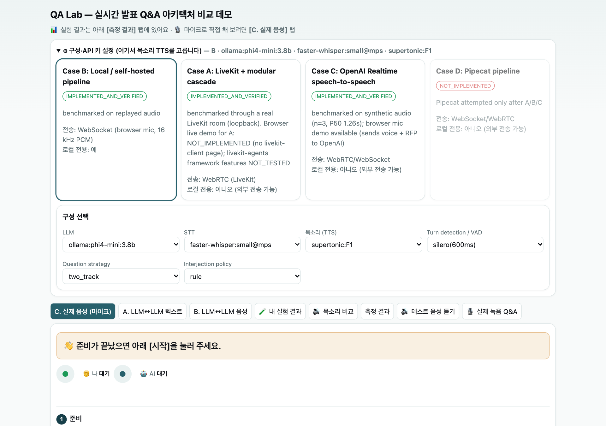
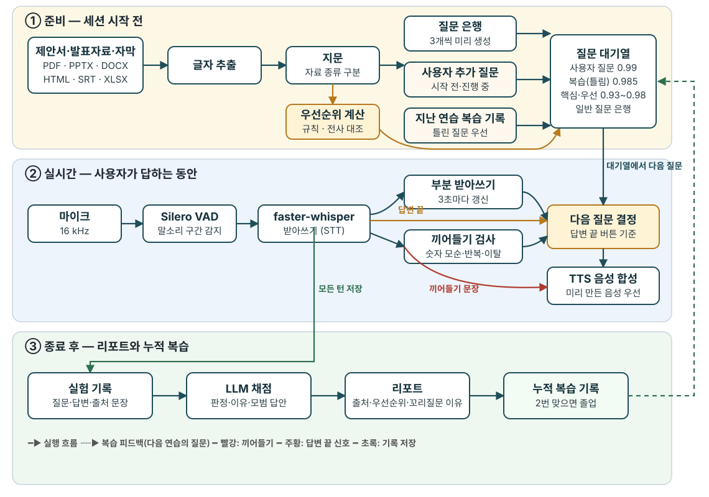
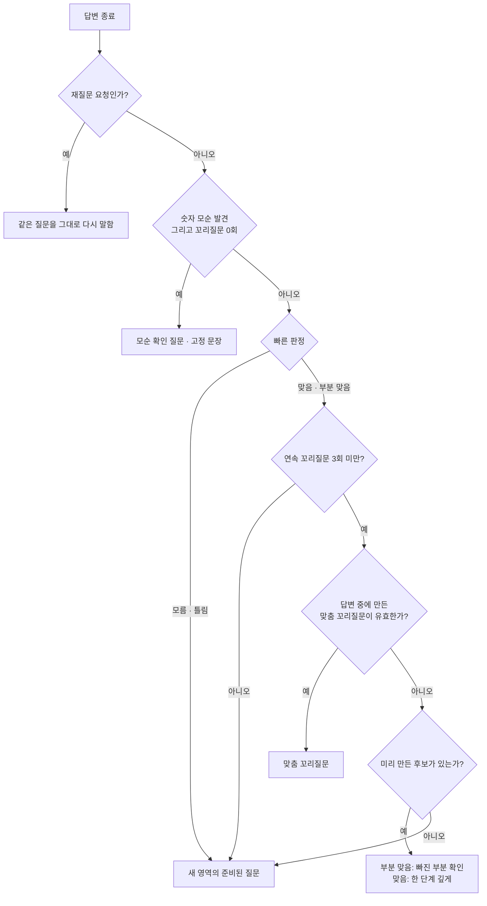
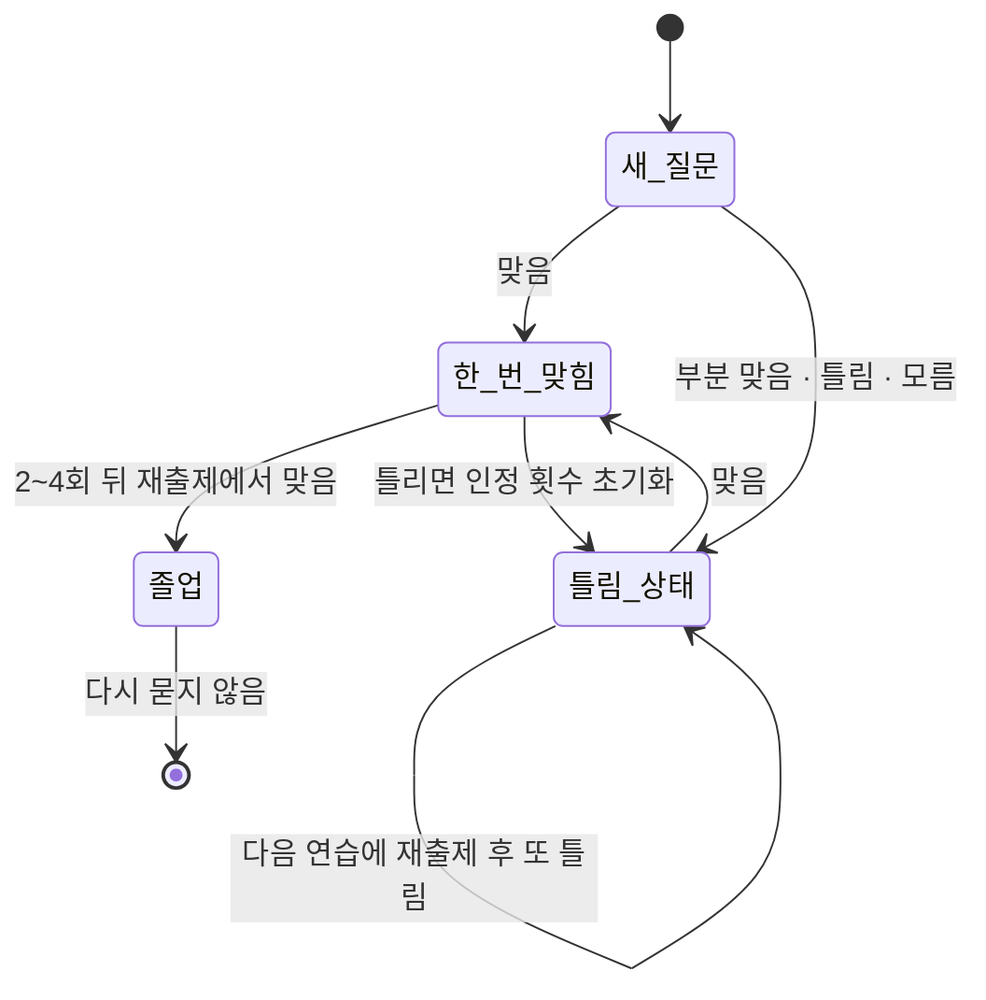

# Real-time Mock Interview · 실시간 음성 모의 면접

[English](README.md) · **한국어**

AI 심사위원이 제안서와 발표자료를 근거로 **음성으로 질문**합니다. 사용자의 답변을 들으며 **꼬리질문**을 준비하고, 필요하면 **끼어듭니다.** 연습이 끝나면 답변별 판정, 모범 답안, 질문의 출처를 담은 **리포트**를 만듭니다. 기본 구성은 음성 인식, 질문 생성, 음성 합성이 모두 사용자의 컴퓨터에서 실행되는 로컬 파이프라인입니다.



> **이 문서의 읽는 법**
> 기능마다 *무엇이 문제였고, 어떤 선택지를 검토했으며, 무엇을 왜 결정했는지*를 적었습니다. 설명은 **현재 코드에 최종 반영된 동작**을 기준으로 합니다. 수치는 대부분 표본이 작은 실험값이므로 경향으로 읽어 주시기 바랍니다.

---

## 목차

1. [핵심 설계 원칙](#1-핵심-설계-원칙)
2. [전체 구조](#2-전체-구조)
3. [모델과 구성 선정](#3-모델과-구성-선정)
4. [자료 입력과 글자 추출](#4-자료-입력과-글자-추출)
5. [첫 질문과 질문 은행](#5-첫-질문과-질문-은행)
6. [질문 품질 관리](#6-질문-품질-관리)
7. [질문 우선순위](#7-질문-우선순위)
8. [꼬리질문](#8-꼬리질문)
9. [끼어들기](#9-끼어들기)
10. [답변 턴과 음성 처리](#10-답변-턴과-음성-처리)
11. [재질문 요청과 사용자 질문 추가](#11-재질문-요청과-사용자-질문-추가)
12. [세션 시간 제한](#12-세션-시간-제한)
13. [리포트, 채점, 출처 검색](#13-리포트-채점-출처-검색)
14. [누적 복습 기록](#14-누적-복습-기록)
15. [지연과 발열 최적화](#15-지연과-발열-최적화)
16. [개인정보와 보안](#16-개인정보와-보안)
17. [설치와 실행](#17-설치와-실행)
18. [검증 범위, 한계, 다음 과제](#18-검증-범위-한계-다음-과제)

---

## 1. 핵심 설계 원칙

| 원칙 | 의미 | 코드에 반영한 방식 |
|---|---|---|
| **속도 우선** | 답변이 끝난 뒤 AI의 첫 소리가 2초 안에 나와야 대화가 이어집니다. | 답변 중에 다음 질문과 음성을 미리 만들고, 채점과 모범 답안은 실시간 경로에서 뺐습니다. |
| **근거 기반** | 질문은 사용자가 넣은 자료에서 나와야 합니다. | 질문마다 출처 문장을 저장하고, 자료를 짚지 않는 일반 질문은 걸러 냅니다. |
| **질문 하나에 한 가지** | 두 가지를 묶은 질문은 답하기도, 채점하기도 어렵습니다. | 생성 지시문과 형태 검사를 함께 적용합니다. |
| **같은 말을 두 번 묻지 않기** | 반복 질문은 연습을 망칩니다. | 질문, 꼬리질문, 끼어들기를 지금까지 한 모든 질문과 비교합니다. |
| **로컬 우선** | 제안서와 목소리는 민감한 정보입니다. | 기본 구성은 외부 전송이 없습니다. 클라우드 모델은 선택해야만 사용합니다. |
| **한 번에 하나만 바꾸기** | 여러 값을 함께 바꾸면 원인을 알 수 없습니다. | 모델 선정은 토너먼트로, 지연 최적화는 단일 변수 실험으로 진행했습니다. |

---

## 2. 전체 구조



### 실행 방식(Case) 비교

같은 질문 엔진을 세 가지 전송·음성 구조에 연결해 비교했습니다.

| Case | 구성 | 첫 소리까지 P50 (합성 음성 3개) | 장점 | 제약 |
|---|---|---|---|---|
| **B (채택)** | VAD → faster-whisper → 로컬 LLM → 로컬 TTS | 2.00초 | 질문 내용을 완전히 통제하며 외부 전송이 없습니다. | 장비 성능의 영향을 받습니다. |
| A | B와 같은 처리 + LiveKit(WebRTC) 전송 | 2.14초 | 실시간 통신 표준을 사용합니다. | 루프백만 시험했고 브라우저 화면은 만들지 않았습니다. |
| C | OpenAI Realtime 음성 대 음성 | 1.26초 | 가장 빠릅니다. | 모델이 질문을 직접 만들어 통제가 어렵고, 음성이 외부로 나갑니다. |
| D | Pipecat | 구현하지 않음 | — | — |

위 표는 초기 비교(토너먼트와 최적화 이전)의 값입니다. **B를 채택한 이유**는 속도 1위가 아니라 *질문 통제력, 근거 추적, 개인정보 보호*였습니다. 이후 최적화로 B의 응답 시간을 크게 줄였습니다([15절](#15-지연과-발열-최적화)).

---

## 3. 모델과 구성 선정

### 3.1 선정 방식: 토너먼트

가능한 조합을 모두 재면 수백 개가 되고 장비 발열도 큽니다. 그래서 **한 번에 한 축만 바꾸고 나머지는 현재 최선으로 고정한 뒤, 상위 2개만 다음 단계로 올리는** 토너먼트를 설계했습니다.

| 단계 | 바꾼 축 | 측정한 조합 |
|---|---|---|
| 1단계 | STT, TTS, 끼어들기 정책, 질문 전략 | 14 |
| 2단계 | LLM(내장 Ollama와 외장 저장소 모델) | 14 |
| 결승 | 상위 후보의 조합 | 14 |
| 클라우드 라운드 | 클라우드 LLM(별도 레인) | 5 |

- **장비:** Apple M2 Pro 32GB(Metal GPU)
- **입력:** 합성 한국어 음성. 모든 조합에 같은 파일을 재생했습니다. 클라우드 조합이 있으므로 실제 녹음은 사용하지 않았습니다.
- **표본:** 단계에 따라 시나리오 3~5개, 각 1회

### 3.2 점수 산출식

`점수 = 100 × Σ(지표 점수 × 가중치) ÷ Σ(측정한 지표의 가중치)`

| 지표 | 정의 | 가중치 |
|---|---|---|
| 쓸 만한 비율 | 첫 소리 2.0초 이내**이면서** 질문 품질 3.5/5 이상인 시나리오 비율 | 30% |
| 질문 품질 | 심사 모델이 관련성·근거·깊이·자연스러움을 1~5점으로 채점 | 20% |
| 응답 속도 | `답변 끝` 버튼부터 AI 첫 소리까지(1초 이하 만점, 3초 이상 0점) | 20% |
| 받아쓰기 정확도 | 글자 오류율(CER) | 10% |
| 끼어들기 정확도 | 정답 라벨이 있는 시나리오의 F1 | 10% |
| 비용 | 질문 1,000개당 클라우드 추정 비용 | 5% |
| 프라이버시 | 음성·텍스트의 외부 전송 여부 | 5% |

*속도만 빠르거나 품질만 좋은 조합*이 1위가 되지 않도록 "쓸 만한 비율"에 가장 큰 가중치를 두었습니다. 실제로 미리 만든 질문만 읽는 `precomputed` 전략은 0.5초로 가장 빨랐지만 품질이 2.9점이어서 순위가 낮았습니다.

### 3.3 결승 랭킹


전체 47개 조합의 순위는 [전체 랭킹 화면](docs/images/ranking_full.png)과 [docs/RANKING.md](docs/RANKING.md)에서 확인할 수 있습니다. 점수 차이가 ±3점 이내이면 동률로 해석합니다.

> 화면에서 ⭐로 표시된 "데모 기본 적용" 구성은 **토너먼트를 진행한 시점**의 설명입니다. 이후 기본 음성을 바꾸었으므로 현재 기본값은 아래 표를 따릅니다.

### 3.4 최종 채택 구성

| 구성 요소 | 최종값 | 결정 근거 |
|---|---|---|
| LLM | `phi4-mini:3.8b` (Ollama) | 결승 1위(95.5점)였습니다. 2위 `qwen3.5:4b`(92.8점)와는 사실상 동률이며 응답이 더 빨랐습니다(1.02초 대 1.42초). |
| STT | `faster-whisper small` (MPS) | `large-v3-turbo`는 실제 사람 음성에서 더 정확했지만 2초 이내 비율이 낮았습니다. |
| 질문 전략 | `two_track` | 실시간에는 가벼운 판단만 하고 깊은 분석은 뒤에서 실행합니다. `direct`(4.7초), `hybrid`(4.5초)보다 훨씬 빨랐습니다. |
| 끼어들기 | `rule` | 합성 시험에서 세 정책의 F1이 같았고, 규칙 방식이 가장 빠르며 LLM 호출이 없습니다. |
| TTS | `Supertonic 3` 한국어 `F1` (ONNX, 로컬) | 토너먼트는 macOS AVSpeech로 진행했습니다. 이후 목소리를 비교해 기본값을 바꾸었으며, **Supertonic 구성은 토너먼트로 다시 채점하지 않았습니다.** |
| VAD | Silero VAD(600ms) | 자동 감지 방식에서 사용합니다. |
| 턴 방식 | 버튼(`manual`) | [10절](#10-답변-턴과-음성-처리) 참고 |

> 위 값은 `/v2` 화면의 기본 선택값입니다. WebSocket 주소에서 값을 생략하면 서버 기본값(`qwen2.5:7b`, 끼어들기 `hybrid`)이 적용됩니다. 외부 화면을 연결할 때는 값을 명시해 주시기 바랍니다.

### 3.5 보조 실험에서 확인한 사실

| 실험 | 결과 | 설계에 준 영향 |
|---|---|---|
| 실제 음성 받아쓰기 3개 | CER: base 0.164, small 0.165, turbo 0.111 | 정확도 여유는 turbo에 있지만 속도를 우선했습니다. |
| 침묵 길이로 답변 끝 판단 | 한 답변을 평균 3.7번(0.6초 기준) 끊었습니다. 2.0초가 되어야 1번이었습니다. | 버튼으로 답변을 끝내는 방식을 기본으로 했습니다. |
| LLM 동시 실행 중 받아쓰기 | 평균 0.53초 → 1.05초 | 답변이 끝나면 백그라운드 LLM 작업을 멈춥니다. |
| 심사 모델 신뢰도 | 기준 심사 모델과의 상관: 로컬 0.54~0.61, 저가 클라우드 0.79 | 로컬 모델의 점수는 절대값이 아닌 참고 순위로만 해석합니다. |

자세한 방법과 한계는 [docs/MINI_SUITE.md](docs/MINI_SUITE.md)에 있습니다.

---

## 4. 자료 입력과 글자 추출

발표 코칭에 쓰는 자료는 보통 **① 제안서 또는 RFP, ② 발표자료, ③ 발표 전사(STT)** 의 세 종류입니다. 파일 종류에 상관없이 올리면 글자를 꺼내 지문에 붙입니다.

| 형식 | 처리 방식 |
|---|---|
| PDF | `pypdf`로 읽고, 글자가 거의 없으면 `pdftotext`(설치된 경우)로 다시 시도합니다. |
| PPTX | 슬라이드 번호별 글자, 표, 그룹 도형, 발표자 노트를 읽습니다. |
| DOCX · XLSX | 문단과 표, 시트별 행을 읽습니다. |
| DOC · RTF | macOS `textutil`로 변환합니다. |
| HTML | 스크립트와 태그를 제거합니다. |
| SRT · VTT | 번호와 시간 표시를 지우고, 반복된 자막은 한 번만 남깁니다. |
| JSON | Whisper 형식의 `segments`를 이어 붙입니다. |
| TXT · MD · CSV | UTF-8, UTF-16, CP949, EUC-KR 순서로 해석합니다. |

- **형식 판별:** 파일 이름보다 **내용(바이트 서명)** 을 먼저 확인합니다.
- **읽지 못하는 파일:** 스캔 PDF와 이미지(OCR 미연결), 구형 `.ppt`, `.hwp`는 저장 형식을 바꾸라는 안내를 보여 줍니다.
- **크기 제한:** 파일은 60MB, 지문은 150,000자까지입니다. 업로드한 파일 자체는 저장하지 않습니다.


*위 화면의 파일은 설명용으로 만든 합성 자료입니다.*

---

## 5. 첫 질문과 질문 은행

### 5.1 긴 지문을 다루는 방식

초기에는 지문의 앞 30,000자만 사용했고, 근거 검색에는 문장 14개만 표본으로 썼습니다. 현재는 다음과 같이 처리합니다.

- 지문 상한을 **150,000자**로 늘렸습니다.
- **모든 문장**(최대 1,500개)을 근거 찾기, 모순 검사, 다음 주제 선택에 사용합니다. 합성 지문(5만 자, 600문장)에서 근거 문장 검색은 1ms였습니다.
- 지문 전체를 모델에 넣지 않습니다. **문장 단위**로만 전달합니다.
- 붙여 넣은 웹 문서의 시각 표시, 분류 목록, 표 잔여물, `[음악]` 같은 자막 표시는 먼저 제거합니다.

### 5.2 첫 질문

첫 질문 때문에 시작이 늦어지지 않도록 **지문 앞부분(약 700자의 온전한 문장)만으로** 만듭니다.

1. 지문을 넣으면 질문 은행이 백그라운드에서 만들어지기 시작합니다. 은행이 준비돼 있으면 그 첫 질문(지문 앞부분 기반)을 바로 사용합니다.
2. 아직 없으면 앞부분으로 첫 질문 하나만 즉시 만듭니다(최대 2회 시도).
3. 모델이 실패하거나 일반 질문을 만들면, 앞부분의 구체적인 용어를 짚어 **"○○의 근거나 수치를 말씀해 주시겠어요?"** 로 대신합니다.

> **결정 배경:** "이 글의 핵심 내용을 본인의 말로 설명해 주시겠어요?"처럼 어느 문서에나 쓸 수 있는 질문은 제안서 코칭에 맞지 않습니다. 이런 문구는 생성 지시문, 품질 검사, 대체 문구, 복습 기록의 네 곳에서 모두 막습니다.

### 5.3 질문 은행

| 항목 | 값 |
|---|---|
| 한 번에 만드는 수 | **3개** |
| 보충 시점 | 아직 묻지 않은 질문이 **1개 이하** |
| 생성 단위 | 문장 하나당 모델 호출 1회(0.3~0.7초) |
| 문장 선택 | 황금비 간격으로 건너뛰며, 지문의 초반·중반·후반을 번갈아 선택 |
| 우선권 | 답변을 처리하는 동안에는 생성을 멈추고 실시간 응답에 모델을 양보 |

**검토한 선택지와 결정**

| 방식 | 한 라운드 | 첫 라운드 소요 | 14개를 만드는 CPU 시간 |
|---|---|---|---|
| 처음에 14개와 모범 답안, 꼬리질문 후보까지 생성 | LLM 약 43회 호출 | 발열이 컸습니다. | — |
| 7개씩, 2개 남으면 보충 | 6.4~8.5초 | 8.5초 | 약 15초 |
| **3개씩, 1개 남으면 보충 (채택)** | 약 1.8초 | 1.9초 | 약 8.4초 |

당시 실험에서 질문 하나는 평균 약 35초 동안 사용됐으므로, 3개 보충은 충분히 먼저 끝납니다. 사용하지 않고 버려지는 질문도 줄었습니다. *이 시간은 이후 품질 필터를 강화하기 전에 잰 값입니다. 필터를 강화한 뒤에는 한 라운드가 5~8초까지 걸린 경우가 있었습니다.*

---

## 6. 질문 품질 관리

작은 로컬 모델은 지시문의 규칙을 모두 지키지 못합니다. 지시문을 늘려도 통과율이 오르지 않았기 때문에, **생성은 가볍게 하고 코드 필터로 거르는 방식**을 택했습니다.

| 검사 | 거르는 예 |
|---|---|
| 한 가지만 묻기 | 55자 초과, "~이해하고 있나요?" 같은 확인형, 두 대상의 접속, 요청 두 개, 물음표 두 개, "~인지, ~"처럼 쉼표로 이은 이중 질문 |
| 읽기 어려운 문장 | 수식어와 "~의"가 겹친 문장, "~의"의 연속 |
| 말투 | "~냐고", "~지냐", "~아니냐" 같은 반말투, 존댓말 의문형이 아닌 끝맺음 |
| 일반 질문 | "핵심 내용", "본인의 말로", "이 글의" |
| 맥락 없는 지시어 | "이 문장", "이 그림", "그 부분"처럼 듣는 사람이 알 수 없는 대상. 대상이 문장 안에 있으면 지시어만 제거합니다. |
| 문서 잔여물 | 날짜·시각, 편집 표시, 영상 제목 조각, 한자·일본어 혼입 |
| 근거 확인 | 질문의 핵심어가 출처 문장에 있어야 합니다. "이유"를 물으려면 문장에 이유 표현이 있어야 합니다. |
| 말 겹침 | "통화 기능과 통화 기능의…"처럼 같은 말이 반복된 문장 |
| 중복 | 지금까지 한 모든 질문과 문장 유사도 및 핵심어 겹침 비교 |

엄격한 근거 검사만 통과하지 못한 질문은 **예비 목록**에 보관해 은행이 바닥나지 않게 합니다. 단, 예비 질문도 *한 가지만 묻기* 검사는 반드시 통과해야 합니다.

> **남은 한계:** 필터는 나쁜 문장을 막을 뿐 모델의 한국어 유창성을 높이지는 못합니다. 필터를 엄격하게 할수록 사용할 수 있는 질문이 줄어듭니다.

---

## 7. 질문 우선순위

**자료와 발표를 읽고, 무엇을 먼저 물을지 정합니다.** 중요도는 모델이 점수를 매기지 않고 **코드가 규칙으로 계산**합니다. 몇 밀리초 안에 끝나므로 첫 질문과 다음 질문이 기다리지 않으며, 순위마다 **이유**를 설명할 수 있습니다.


*위 화면의 자료는 설명용 합성 데이터입니다.*

### 7.1 검토한 선택지

| 방식 | 판단 |
|---|---|
| 생성 순서 (이전 방식) | 중요한 내용을 먼저 묻는다는 보장이 없었습니다. |
| LLM이 문장마다 0~1점 | 모델 호출이 늘어 지연과 발열이 커지고, 작은 모델의 점수는 기준과 이유를 설명하기 어렵다고 판단했습니다. (점수 품질을 비교 측정하지는 않았습니다.) |
| **규칙 계산 + 모델은 보조 (채택)** | 수치·평가 배점·자료 간 비교는 규칙으로 처리합니다. 모델은 *차별점을 말하는 문장 번호*를 고르는 데만 선택적으로 사용하므로 새 내용을 지어낼 수 없습니다. |

### 7.2 자료 구분

우선 질문은 자료마다 머리말이 있을 때 만듭니다. 파일을 올리면 머리말이 자동으로 붙으며, 직접 고칠 수 있습니다.

`[RFP: 이름]` · `[제안서: 이름]` · `[발표자료: 이름]` · `[발표 전사: 이름]`

- **발표 전사는 비교에만 사용합니다.** 받아쓰기 오류가 사실처럼 쓰이지 않도록 질문 은행, 채점 기준, 복습 기록의 근거에서 제외합니다.
- 머리말 없이 붙여 넣은 일반 글은 이전과 같이 동작하며, 우선 질문을 만들지 않습니다.

### 7.3 핵심 항목

금액과 목표처럼 중요한 내용은 **발표에 문제가 없어도 묻습니다.**

| 분류 | 찾는 단서 |
|---|---|
| 예산 | 예산, 사업비, 비용, 인건비, 금액 표현 |
| 필수 요건 | 필수, 반드시, 의무, 준수, "~해야 한다" |
| 목표·성과 | 목표, 성과, 지표, 달성, 향상 |
| 차별점 | 차별, 핵심 전략, 강점 + (선택) 모델이 고른 문장 |
| 수행체계 | 추진 체계, 조직, 투입 인력, 참여 기관 |
| 범위·일정 | 대상, 인원, 기간, 일정 |

분류마다 최대 2개를 고르며, 수치가 있고 평가 배점이 높고 여러 자료에 반복되는 문장을 우선합니다.

**평가 배점**은 RFP의 `사업 이해도 20점`, `수행 능력 | 30`과 같은 줄에서 읽습니다.

### 7.4 등급과 점수

| 등급 | 조건 | 기본 점수 |
|---|---|---|
| 1 | 핵심 항목의 값이 **자료와 발표에서 다르거나, 자료끼리 다름** | `0.975` |
| 2 | 핵심 항목이 **발표에서 빠졌거나 근거가 없음** | `0.965` |
| 3 | 핵심 항목을 **근거까지 설명함** → 한 단계 깊게 | `0.955` |
| 4 | 일반 수치의 불일치 | `0.945` |
| 5 | 평가 항목이 발표에서 빠짐 | `0.935` |
| 6 | 평가 항목을 언급했으나 근거가 없음 | `0.925` |

- **점수 = 기본 점수 + 배점 × 0.00008.** 100점을 더해도 0.008이므로 등급 간격(0.01)을 넘지 못합니다. 배점은 **같은 등급 안의 순서**만 바꿉니다.
- 우선 질문은 최대 10개입니다. 핵심 항목의 등급이 앞서므로 핵심 질문이 먼저 자리를 차지합니다.
- 설명한 핵심 항목은 같은 내용을 되묻지 않습니다. 예를 들어 예산을 설명했다면 *"가장 큰 변동 위험은 무엇인가요?"* 처럼 묻습니다.
- 발표 전사가 없으면 핵심 항목의 근거를 묻습니다.
- 전사 오류 가능성이 있으므로 발표와의 불일치는 *"발표에서는 100명으로 들었습니다. 어느 쪽이 맞습니까?"* 처럼 **확인하는 말투**를 씁니다.

- 금액은 값으로 비교합니다. `1,200만원`과 `12,000,000원`은 같은 값입니다.

### 7.5 연습 중 갱신

답변이 끝날 때마다 남은 우선 질문을 규칙으로 다시 확인합니다.

| 대기 중인 질문 | 앞선 답변에서 근거까지 설명하면 |
|---|---|
| 핵심 항목의 근거·누락 (2등급) | 근거를 되묻지 않고 **심화 질문(3등급)** 으로 바꿉니다. |
| 평가 항목 (5·6등급) | 대기열에서 뺍니다. |
| 값 불일치 (1·4등급) | 확인이 필요하므로 남겨 둡니다. |

### 7.6 전체 질문 순서

| 질문 종류 | 점수 |
|---|---|
| 첫 질문 | `1.00` |
| 사용자가 추가한 질문 | `0.99 − 0.001 × 순번` |
| 복습: 지난번에 틀린 질문 | `0.985 − 0.001 × 순번` |
| **핵심·우선 질문** | `0.925 ~ 0.984` |
| 일반 질문 은행 | 우선 질문이 있으면 `0.6 − 0.005 × 순번`, 없으면 `1.00 − 0.02 × 순번` |
| 복습: 한 번 맞힌 질문 | `0.3~0.9` 무작위 |
| 즉석 생성 | `0.4` |

- 점수는 백분율이 아니라 **묻는 순서를 정하는 값**입니다.
- 대기 중인 비슷한 질문은 하나로 합치며, 이때 더 높은 점수를 사용합니다.
- 꼬리질문은 대기열을 거치지 않고 바로 이어집니다. 따라서 **꼬리질문이 많으면 정해진 턴 안에서 우선 질문을 모두 묻지 못할 수 있습니다.**

### 7.7 한계

- 분류와 비교는 **키워드 규칙**입니다. 표현이 크게 다르면 놓치고, 관련 없는 문장을 핵심으로 고를 수 있습니다.
- 값 불일치는 **같은 단위이고 핵심어가 2개 이상 겹칠 때**만 판정합니다. 오탐을 줄이기 위한 보수적인 기준입니다.
- 배점표는 위에 적은 두 가지 줄 형식만 읽습니다.
- **합성 자료로만 검증했습니다.** 실제 RFP에서의 정확도, 그리고 사람이 매긴 순위와의 일치도는 아직 확인하지 않았습니다.
- 모델이 차별점 문장을 고르는 보조 기능의 **선택 정확도는 평가하지 않았습니다.** 실패해도 규칙 결과는 그대로 사용합니다.
- 발표 전사는 **파일(자막·텍스트) 업로드**로 받습니다. 발표 중 실시간 전사를 연결하는 기능은 아직 없습니다.

---

## 8. 꼬리질문

### 8.1 정의

> **꼬리질문은 "방금 한 말"을 짚어 한 걸음 더 묻는 질문입니다.** 같은 질문을 다시 묻거나 자료에 없는 내용을 지어내는 것은 꼬리질문이 아닙니다.

### 8.2 다음 질문을 고르는 흐름



**빠른 판정**은 LLM을 호출하지 않고 다음 질문의 방향만 정합니다.

- "모르겠습니다"류의 짧은 답은 `모름`입니다.
- 답변과 관련 지문 문장의 핵심어가 4개 이상 겹치면 `맞음`, 2개 이상이면 `부분 맞음`, 그보다 적으면 `틀림`입니다.

이 판정은 **점수가 아닙니다.** 리포트의 판정은 연습이 끝난 뒤 LLM이 따로 내립니다([13절](#13-리포트-채점-출처-검색)).

> **결정 배경:** 틀렸거나 모른다고 답한 영역을 계속 파고들면 답할 수 없는 질문이 이어집니다. 이런 경우에는 새 영역으로 넘어갑니다.

### 8.3 생성 조건: 답변 중에 만드는 맞춤 꼬리질문

답변이 끝난 뒤에 만들기 시작하면 2초를 넘깁니다. 그래서 **사용자가 말하는 동안** 부분 받아쓰기를 보고 만듭니다.

**① 시작 조건**
- 부분 받아쓰기가 **15자 이상**입니다. (처음에는 40자였고, 15자로 낮춘 뒤 준비 시점이 10.2초에서 6.0초로 빨라졌습니다.)
- 질문 은행 보충이 급하지 않습니다.
- 이전에 만든 뒤 새 내용이 40자 이상 늘었거나, 처음 만드는 경우입니다.

**② 근거 찾기** — 다음 조건을 모두 만족하는 지문 문장을 찾습니다.
- 답변의 단어가 **질문에는 없던 새 단어**입니다.
- 그 단어가 지문의 **2개 이하 문장**에만 나오는 희귀한 단어입니다.
- 꼬리질문에 **이미 사용한 문장이 아닙니다.**
- 영문·숫자 용어이거나, 일반 한글 단어는 2개 이상 겹쳐야 합니다.

**근거 문장을 찾지 못하면 꼬리질문을 만들지 않습니다.**

**③ 유형 선택** — 위에서부터 조건을 확인하며, 직전과 같은 유형은 피합니다.

| 유형 | 조건 |
|---|---|
| 더 자세히 | 새 용어를 말한 부분이 짧습니다. |
| 검증 | 지문 문장에 측정·검증·확인·기준 표현이 있는데 답변에는 없습니다. |
| 근거 | 지문 문장에 이유·필요 표현이 있는데 답변에는 없습니다. |
| 순서 | 지문의 3단계 이상 절차에서 답변이 중간 단계를 건너뛰었거나 앞에서 멈췄습니다. 고정 틀을 사용하므로 LLM 호출이 없습니다. |
| 더 깊이 | 근거 문장은 있지만 위 조건에 해당하지 않을 때의 마지막 선택입니다. |

**④ 통과 검사**
- 8~110자의 한국어이며, 한 가지만 묻습니다.
- 존댓말 의문문으로 끝납니다.
- 이미 한 질문과 비슷하지 않습니다.
- 답변 문장을 60% 넘게 베끼지 않았습니다.
- **답변에서 새로 나온 용어를 포함합니다.**

**⑤ 사용 직전 확인** — 최종 답변의 핵심어가 생성 시점 핵심어의 60% 이상을 유지해야 사용합니다. 답변이 끝날 때까지 완성되지 않은 생성은 취소합니다. 실행 중인 LLM이 받아쓰기를 약 2배 느리게 만들기 때문입니다.

### 8.4 미리 만든 후보

질문을 말한 직후, 그 질문의 **"더 깊게"** 와 **"빠진 부분"** 후보를 출처 문장만 근거로 미리 만들어 둡니다. 맞춤 꼬리질문이 없으면 이 후보를 사용합니다.

### 8.5 연속 횟수와 연결 문구

- 한 질문에서 연속 꼬리질문은 **최대 3회**입니다. 자료를 조사한 결과 1~3회가 일반적이었지만 확립된 연구 표준은 찾지 못했으므로, 설계 선택값입니다.
- 갑작스럽게 들리지 않도록 *"답변 잘 들었습니다. ○○ 부분의 근거를 여쭤볼게요."* 같은 짧은 연결 문구를 붙입니다. 두 번째부터는 *"좋습니다. 이어서 하나만 더 여쭤볼게요."* 를 사용합니다.
- 연결 문구의 음성은 가장 먼저 미리 합성합니다.
- 꼬리질문의 **지문 출처 문장은 그대로 저장**하며, 미리 만든 후보는 부모 질문의 출처를 물려받습니다.
- 리포트에는 꼬리질문이 붙었거나 붙지 않은 **이유를 한 줄**로 남깁니다.

> **측정 결과:** 합성 답변 시험에서 답변 기반 꼬리질문의 통과가 10회 중 1회에서 20회 중 8~9회(40~45%)로 늘었고, 작성 시간 중앙값은 1.2초에서 0.8초로 줄었습니다. *이 값은 최근의 "한 가지만 묻기" 강화(55자 제한 등) 이전에 잰 것입니다.*

---

## 9. 끼어들기

답변 중 **3초마다** 최근 14초 분량의 부분 받아쓰기를 검사합니다. 답변을 시작한 지 3초가 지난 뒤부터 적용합니다.

| 상황 | 기본 규칙(`rule`) |
|---|---|
| 지문과 다른 숫자 | 같은 단위이고 관련 단어가 겹치는데 값이 지문의 조건과 다릅니다. |
| 앞 답변과 다른 숫자 | 같은 단위의 다른 값이며 핵심어가 3개 이상 겹칩니다. |
| 같은 말 반복 | 3어절 묶음의 반복 비율이 30%를 넘습니다. |
| 주제 이탈 | 8초가 지났고 60자를 넘겼는데 질문 핵심어와의 겹침이 20% 미만입니다. |
| 지나치게 긴 답변 | 75초를 넘습니다. |

- **문장:** 정중한 시작, 짧은 이유, 발언권 돌려주기의 3단 구조인 고정 문장입니다. LLM을 호출하지 않으며 음성을 미리 만들어 둡니다.
- **반복 방지:** 이미 사용한 문장은 다시 말하지 않습니다.
- **재무장:** 한 번 끼어든 뒤에는 그 이후에 한 말만 새로 판단합니다.
- **다른 정책:** `llm`(모델 판단)과 `hybrid`(규칙으로 감지한 뒤 모델이 확인)를 선택할 수 있습니다.

**결정한 행동 원칙:** 질문과 무관한 이야기는 끊고 방향을 돌립니다. 모호한 답은 끊지 않고 추가 질문으로 확인합니다. 일반 사실의 오류 판별은 비용과 지연 때문에 구현하지 않았으며, 현재는 **숫자 모순**만 감지합니다.

> **한계를 그대로 밝힙니다.** 위 기준값(3초, 20%, 30%, 60자, 75초 등)은 논문에 근거한 값이 아닌 **시작값**입니다. "주제 이탈" 글자 수는 14초 검사 창에서 보통 말하기 속도로 약 75~93자만 담긴다는 계산에 따라 90자에서 60자로 낮췄습니다. 합성 시험에서는 F1이 1.0이었지만, 실제 사람 음성에서는 규칙 방식이 정상 답변을 주제 이탈로 오판한 사례가 많았습니다(초기 시험 9회 중 7회). 이후 연습 기록으로 조정했으나 **실제 음성에서의 충분한 검증은 아직 필요합니다.**

---

## 10. 답변 턴과 음성 처리

### 10.1 답변 끝 판단

| 검토한 방식 | 결과 |
|---|---|
| 침묵 길이 | 짧으면 말하는 도중에 끊고, 길면 응답이 늦어집니다. |
| 침묵 + 문장 끝맺음 | 한국어 종결 어미가 문장 중간에도 자주 나와 0.6초 기준보다 나빴습니다. |
| 미리 생성 + 1.5초 확인 (자동 방식) | 답변당 끊김이 2.7회에서 1.3회로 줄었습니다. |
| **버튼으로 끝내기 (채택)** | 사용자가 끝을 직접 알리므로 말하는 도중에 끊기지 않습니다. |

버튼 방식에서도 말을 잠시 멈추는 구간마다 앞부분을 **미리 받아쓰기** 해 두므로, 버튼을 누른 뒤에는 남은 끝부분만 처리합니다.

### 10.2 화면 조작

- 핵심 버튼은 **시작, 답변 끝(스페이스), 전체 끝내기** 3개입니다.
- 질문 다시 듣기와 건너뛰기는 보조 버튼입니다. 건너뛰기는 준비된 질문을 즉시 사용하고, 없으면 최대 4초 안에 만듭니다.
- 원하면 **말하기 버튼(push-to-talk)** 도 켤 수 있습니다.

### 10.3 받아쓰기 안정화

| 문제 | 대응 |
|---|---|
| 잡음에서 용어 힌트를 그대로 읽어 옵니다. | 힌트를 단어 목록 대신 문장으로 바꾸고, 새어 나온 힌트는 제거합니다. |
| 무음에서 "…뉴스 기자입니다" 같은 환각이 생깁니다. | 알려진 환각 문구를 제거합니다. |
| 같은 글자가 길게 반복됩니다. | 비정상 반복을 제거합니다. |
| "네" 같은 한 글자 답변이 버려집니다. | 실제 답변인 한 음절은 허용합니다. |
| 말을 마치자마자 버튼을 누르면 다음 답변이 "말씀하신 내용이 없습니다"로 거절됩니다. | 버튼으로 턴을 끝낼 때 음성 감지기(VAD) 상태를 초기화합니다. |
| 전문 용어를 틀리게 받아씁니다. | 지문의 영문 용어를 받아쓰기 힌트로 전달합니다. |

### 10.4 음성 합성

- 자주 쓰는 문장(다음 질문, 꼬리질문 후보, 끼어들기 문장, 연결 문구)은 **미리 합성해 저장**합니다.
- 첫 음성 조각은 쉼표나 14자 부근에서 먼저 내보냅니다.
- 한국어 목소리가 영어 단어에서 억양이 바뀌지 않도록, **소리로 읽을 때만** 영어를 한글 발음으로 바꿉니다. 화면의 글자는 그대로입니다.

---

## 11. 재질문 요청과 사용자 질문 추가

### 11.1 "다시 말씀해 주세요"

실제 발표 평가에서도 질문이 잘 들리지 않으면 다시 말해 달라고 요청할 수 있습니다.

| 요청 | 동작 |
|---|---|
| "다시 말씀해 주세요", "너무 빨라요" | 같은 질문을 **그대로** 다시 말합니다. |
| "더 쉽게 말씀해 주세요", "무슨 뜻인가요" | **쉽게 바꾸지 않고** 같은 질문을 그대로 다시 말합니다. |

> **결정 배경:** 처음에는 LLM이 질문을 쉽게 바꾸도록 만들었으나 철회했습니다. 심사위원은 질문의 수준을 유지해야 하며, 이해한 만큼 답한 결과는 리포트에서 평가됩니다. 따라서 힌트를 주지 않습니다.

- 규칙으로 감지하며 LLM 호출이 없습니다. 60자 이상의 긴 답변에 이런 단어가 섞인 경우는 요청으로 보지 않습니다.
- 요청한 턴은 **답변이 아니므로 채점하지 않으며**, 리포트에 따로 표시합니다.

### 11.2 내가 묻고 싶은 질문

- 키워드나 반쪽 문장만 적어도 **지문에 맞춘 질문 한 문장**으로 다듬습니다. (최대 10개)
- LLM 변환은 **질문을 추가할 때** 한 번만 실행합니다. 세션 시작과 진행 중 추가에는 LLM을 사용하지 않아 지연이 없습니다.
- 진행 중에 추가한 키워드는 *"○○에 대해 제안서의 근거를 말씀해 주시겠어요?"* 형태로 즉시 바꿉니다.
- 이미 한 질문과 같으면 제외하고, 대기 중인 비슷한 질문이 있으면 그 질문을 **내 질문**으로 올립니다.
- 리포트에 *내가 추가한 질문인지, 우선순위 점수와 내가 쓴 원문*을 표시합니다.

---

## 12. 세션 시간 제한

**10분, 20분, 30분** 또는 *제한 없음*을 선택합니다. 시간은 첫 질문부터 계산합니다.

| 시간이 끝난 시점 | 동작 |
|---|---|
| 사용자가 말하는 중 | **끝까지 듣고** 마무리합니다. |
| 답변을 처리하는 중 | 새 질문 대신 마무리 멘트를 합니다. |
| AI가 질문하는 중 | 질문을 마친 뒤 답을 기다립니다. |
| 10초 동안 아무 말이 없음 | 마무리 멘트를 합니다. |

마무리 멘트는 *"네~ 여기까지 들었습니다. 오늘 발표 수고하셨습니다."* 이며, 약 5초 뒤 자동으로 리포트를 만듭니다.

> 현재 제한: 시간이 끝난 뒤 들은 **마지막 답변은 화면 대화 기록에는 남지만 리포트 집계에는 포함되지 않습니다.** 실제 마이크로 전체 시간을 진행하는 검증은 하지 않았고, 대기와 마무리 로직은 단위 테스트로 확인했습니다.

---

## 13. 리포트, 채점, 출처 검색

### 13.1 채점을 실시간에서 분리한 이유

처음에는 세션 중에도 채점하고 모범 답안을 만들었습니다. 같은 로컬 모델을 함께 사용하면 **받아쓰기와 다음 질문이 느려지고 발열이 커졌습니다.** 실제 모의 면접에서도 결과는 끝난 뒤에 확인하므로, 세션 중 채점을 모두 제거했습니다.

세션 중에는 채점에 필요한 정보만 저장합니다: 질문, 받아쓴 답변, 그 답변이 어느 질문의 답인지, **질문의 출처 문장**, 단계별 시간.

### 13.2 출처 검색: 검색하지 않고 기억합니다

| 방식 | 설명 |
|---|---|
| 키워드 검색 | 채점할 때 지문에서 비슷한 문장을 다시 찾습니다. |
| **출처 기억 (채택)** | 질문을 **만드는 시점**에 근거 문장(최대 300자)을 함께 저장합니다. |

- 답변 6개로 비교했을 때 속도 차이는 없었습니다(평균 1.68초 대 1.55초). 시간은 입력보다 생성 길이가 좌우했습니다.
- 채택한 이유는 **정확성**입니다. 키워드 검색은 관련 없는 문장을 기준으로 잡아 정상 답변을 `틀림`으로 채점한 사례가 있었습니다.
- 질문 은행의 질문은 생성에 사용한 문장을, 꼬리질문은 **맞춤 생성에 사용한 문장 또는 부모 질문의 출처**를 저장합니다.
- 질문에 저장된 문장이 없는 경우(즉석 생성 질문 등)에는 질문과 핵심어가 가장 많이 겹치는 문장 1개를 사용합니다. 느슨하게 관련된 문장까지 넣으면 채점 기준이 흐려지므로 **1개만** 사용합니다.
- 출처 정보가 없는 과거 기록을 채점할 때만 키워드 검색으로 대신합니다.

### 13.3 채점 방식

- 답변마다 LLM을 **1회** 호출해 `판정(맞음 · 부분 맞음 · 틀림)`, 이유 한 문장, 모범 답안을 함께 만듭니다. 결과 형식이 깨지면 모범 답안만 한 번 더 요청합니다.
- "모르겠습니다"는 LLM 없이 `모름`으로 판정합니다.
- 채점은 **세션이 끝난 뒤 백그라운드**에서 진행하며, 리포트는 먼저 표시한 뒤 판정과 모범 답안을 하나씩 채웁니다. 결과는 저장되므로 다시 열 때 비용이 없습니다. 측정값은 답변 하나당 1.5~2.4초입니다.
- 지문 전체를 모델에 넣지 않습니다. 질문, 답변(최대 600자), 출처 문장(최대 300자)만 전달합니다.

> **채점의 한계:** 3단계 라벨이며 점수가 아닙니다. 기준이 출처 문장 일부이므로 여러 문장에 걸친 답은 불리할 수 있습니다. 로컬 LLM의 채점은 기준 심사 모델과의 일치도가 낮으므로 참고용으로 해석해야 합니다.

### 13.4 리포트에 담기는 정보

- 질문별 **출처 구분**(첫 질문, 지문 기반 질문, 내가 추가한 질문, 꼬리질문 유형과 순번, 끼어들기)과 우선순위 점수
- 우선 질문을 **먼저 물어본 이유**(예: 핵심 항목(예산) · 설명함, 한 단계 깊게)
- 내 답변, 판정과 이유, 모범 답안
- 꼬리질문이 이어지거나 이어지지 않은 이유
- 누적 복습 기록(몇 번째로 맞혔는지, 언제 틀렸는지)
- 단계별 지연(받아쓰기, 질문 생성, 음성 합성)과 2초를 넘긴 턴, 당시 실행 중이던 작업
- 끼어들기 횟수와 오탐·유도 적중, 클라우드 사용 시 추정 비용
- 공유용 Markdown 요약

---

## 14. 누적 복습 기록

같은 지문으로 여러 번 연습할 때, **잘 답한 질문은 줄이고 틀린 질문은 다시** 묻습니다.



- `맞음`만 정답으로 인정합니다. 판정은 **LLM 채점 결과만** 사용하며, 실시간 빠른 판정은 반영하지 않습니다.
- 두 번 맞히면 졸업합니다. 중간에 틀리면 처음부터 두 번을 다시 맞혀야 합니다.
- 한 연습의 복습 질문은 최대 8개이며, 틀린 질문을 먼저 넣습니다.
- 꼬리질문, 끼어들기, 재질문 요청은 누적하지 않습니다.
- 저장해 둔 질문과 모범 답안을 그대로 사용하므로 **LLM 호출이 없습니다.**
- 이전 기록에 저장된 일반 질문은 불러오지 않습니다.

**저장 방식 비교** (같은 조건에서 측정)

| 방식 | 읽기 시간 |
|---|---|
| 과거 리포트 50개를 매번 읽기 | 16.4ms |
| **누적 JSON 파일 1개 (채택)** | 0.8ms |
| SQLite | 0.22ms |

어느 방식도 LLM 호출(초 단위)에 비하면 작으므로 가장 단순한 JSON을 택했습니다. 파일은 중간에 중단돼도 깨지지 않도록 한 번에 교체합니다. 졸업 질문 확인은 유사도 비교(13건 16ms) 대신 출처 문장의 해시 비교(0.014ms)를 사용합니다.

---

## 15. 지연과 발열 최적화

### 15.1 속도를 줄인 방법

| 분류 | 방법 |
|---|---|
| **미리 만들기** | 질문 은행, 꼬리질문 후보, 답변 중 맞춤 꼬리질문, 음성 사전 합성 |
| **실시간 경로 줄이기** | 채점·모범 답안 제거, 규칙 기반 빠른 판정, 고정 끼어들기 문장 |
| **우선권 관리** | 답변 처리 중에는 백그라운드 LLM 작업과 음성 합성을 멈춤 |
| **빠른 시작** | 지문 앞부분으로 첫 질문 생성, 시작 전 모델 미리 불러오기(`/api/prewarm`) |
| **대기 제거** | 답변 끝 버튼, 말하는 도중 구간별 받아쓰기, 준비된 답이 있으면 즉시 확정 |

### 15.2 단일 변수 실험과 채택 기준

속도는 *중앙값이 8% 이상 그리고 0.05초 이상 감소*, 발열은 *Whisper 작업 시간이 15% 이상 감소하고 중앙값 증가가 0.05초 이하*일 때만 채택했습니다. CPU 시간은 실행마다 크게 흔들려 판단 지표에서 제외했습니다.

| 실험 | 결과 | 판정 |
|---|---|---|
| 부분 받아쓰기 간격 2초 → 4초 | Whisper 시간 51% 감소, 응답 중앙값 동일 | 채택 후, 끼어들기 반응을 고려해 **최종 3초** |
| LLM 문맥 4096 → 2048 | 개선 폭이 기준 실행 간 편차보다 작음 | 기각 |
| 받아쓰기 검사 창 14초 → 8초 | 끼어들기 규칙이 요구하는 글자 수와 충돌 | 보류 |
| 꼬리질문 시작 조건 40자 → 15자 | 준비 10.2초 → 6.0초, Whisper 부하 동일 | 채택 |
| 첫 받아쓰기를 3초에 실행 | 준비는 빨라지지만 Whisper 59% 증가 | 보류 |

끼어들기 검사 간격은 4초에서 3초로 줄였습니다. 평균 반응은 계산상 약 2.4초에서 1.9초로 빨라지고, 말하는 시간당 Whisper 작업은 약 29% 늘어납니다.

### 15.3 측정 결과와 해석

| 항목 | 값 | 조건 |
|---|---|---|
| 답변 끝 → 첫 소리 중앙값 | 0.47~0.56초 | 합성 답변 5개, 서버 기준 |
| 첫 실제 음성 실험 평균 | 2.25초 (최대 5.53초) | 최적화 이전의 1회 실행 |
| 준비된 질문이 없어 즉석 생성한 경우 | 약 2~4초 | 미해결 구간 |

> **정직한 해석:** 중앙값은 *미리 만든 질문과 음성을 사용한 경우*의 값입니다. 준비된 질문이 바닥나면 2초를 넘을 수 있습니다. 합성 음성과 작은 표본으로 쟀으며, 브라우저 재생 시점은 포함하지 않았습니다.

상세 기록: [docs/LATENCY_AB.md](docs/LATENCY_AB.md), [docs/LIVE_RUN_LOG.md](docs/LIVE_RUN_LOG.md)

---

## 16. 개인정보와 보안

- 기본 구성(Case B + Ollama + faster-whisper + Supertonic)은 **음성과 지문을 외부로 보내지 않습니다.**
- Case C, `openai:` LLM, OpenAI STT·TTS를 선택하면 음성 또는 텍스트가 **OpenAI로 전송됩니다.** 공개 자료나 합성 자료로만 사용해 주시기 바랍니다.
- 실험에서 클라우드는 합성 데이터에만 사용했고, 실제 녹음은 로컬에서만 처리했습니다.
- API 키는 환경 변수로만 전달합니다.
- 연습 기록(`data/`), 녹음, 모델 파일은 저장소에서 제외합니다. 로컬 연습 기록에는 **받아쓴 답변과 지문 원문**이 저장되므로 공유에 주의해 주시기 바랍니다.
- 데모 서버는 `127.0.0.1`에서만 열리며 **인증이 없습니다.** 외부에 공개하면 안 됩니다. 운영에는 세션별 인증, 저장 기간, 삭제 정책이 필요합니다. ([docs/SECURITY.md](docs/SECURITY.md))

---

## 17. 설치와 실행

검증한 환경은 Apple Silicon macOS와 Python 3.12입니다.

```bash
uv venv --python 3.12 .venv
```

```bash
uv pip install --python .venv/bin/python openai httpx pydantic fastapi "uvicorn[standard]" websockets numpy scipy pytest faster-whisper silero-vad torch soundfile supertonic pypdf python-pptx python-docx openpyxl python-multipart
```

```bash
ollama serve
```

```bash
ollama pull phi4-mini:3.8b
```

- **음성 모델:** Supertonic 3 모델 파일은 저장소에 포함하지 않습니다. `models/tts/supertonic-3/`에 두거나 `SUPERTONIC_DIR`로 위치를 지정해 주시기 바랍니다. macOS 음성(`macos-avspeech:Yuna`)을 사용하려면 `pyobjc-framework-AVFoundation`을 추가로 설치합니다.
- **환경 변수:** `OLLAMA_URL`(기본값 `http://localhost:11434`), `OPENAI_API_KEY`(클라우드 비교를 할 때만 필요)

```bash
.venv/bin/python -m qa_lab serve --port 8765
```

브라우저에서 <http://127.0.0.1:8765/v2> 를 엽니다. 이전 화면은 `/` 에 있습니다.

```bash
.venv/bin/python -m pytest -q tests
```

### 문제 해결

| 증상 | 확인할 것 |
|---|---|
| "질문 생성 중"에서 멈춤 | Ollama가 실행 중인지, 선택한 모델을 받았는지 확인합니다. |
| 첫 질문이 나오지 않음 | 서버 로그의 `ModuleNotFoundError`를 확인합니다. 선택한 TTS의 패키지와 모델 파일이 필요합니다. |
| AI 소리가 들리지 않음 | 화면의 스피커 테스트를 누르거나 "맥 스피커로 직접 재생"을 선택합니다. |

### 코드 구조

```text
qa_lab/
├── core/
│   ├── engine.py          질문 결정, 꼬리질문, 빠른 판정, 채점
│   ├── passage.py         지문 정리, 첫 질문, 질문 은행
│   ├── planner.py         생성 지시문, 질문 품질 필터
│   ├── question_queue.py  우선순위 대기열, 중복 제거
│   ├── importance.py      자료 구분, 핵심 항목, 전사 대조, 우선 질문
│   ├── quantities.py      금액·수치·단위 해석
│   ├── interjection.py    끼어들기 정책
│   ├── clarify.py         재질문 요청 감지
│   ├── user_questions.py  사용자 질문 변환과 등록
│   ├── ledger.py          누적 복습 기록
│   └── extract.py         파일 글자 추출
├── cases/                 실행 방식(A · B · C)과 음성 런타임
├── providers/             VAD · STT · TTS
├── demo/                  FastAPI 서버와 화면(/ , /v2)
├── benchmark/             토너먼트, 지연 실험, 점수 산출
└── simulator/             가상 발표자 시뮬레이션
tests/                     단위·통합 테스트
docs/                      실험 기록, 랭킹, 연동 규격, 보안
results/                   측정 원본(합성 데이터)
```

### 관련 문서

| 문서 | 내용 |
|---|---|
| [RANKING.md](docs/RANKING.md) | 조합 랭킹과 점수 지표 |
| [MINI_SUITE.md](docs/MINI_SUITE.md) | 항목별 비교 실험 |
| [LATENCY_AB.md](docs/LATENCY_AB.md) | 지연·발열 단일 변수 실험 |
| [LIVE_RUN_LOG.md](docs/LIVE_RUN_LOG.md) | 실제 음성 실험에서 찾은 문제와 수정 |
| [TOURNAMENT_PLAN.md](docs/TOURNAMENT_PLAN.md) | 토너먼트 설계 |
| [INTEGRATION_API.md](docs/INTEGRATION_API.md) | 화면 연동용 음성 프로토콜 |
| [SECURITY.md](docs/SECURITY.md) | 보안과 개인정보 |

> 실험 문서는 작성 시점의 기록입니다. 이 README와 값이 다르면 **README와 현재 코드가 최신**입니다.

---

## 18. 검증 범위, 한계, 다음 과제

### 검증한 것
- 합성 자료와 합성 음성으로 서버를 끝까지 실행해, 우선 질문이 등급 순서대로 나오고 답변에 따라 갱신되는 것을 확인
- 자동 테스트: 우선순위, 금액 해석, 대기열, 꼬리질문, 재질문 요청, 사용자 질문, 복습 기록, 수동 턴, 시간 제한, 파일 추출
- 합성 음성을 이용한 모델·구성 비교와 지연 실험
- 파일 업로드: 합성 샘플 파일을 사용한 추출 확인과 브라우저 업로드 확인

### 아직 충분히 검증하지 않은 것
- 최신 품질 필터와 시간 제한을 적용한 **실제 마이크 연습 전체 과정**
- 다양한 화자와 소음 환경에서의 끼어들기 정확도
- 여러 사용자의 동시 접속. 지문과 사용자 질문이 서버에 하나씩만 저장되므로 **한 사람 사용**을 전제로 합니다.

### 알려진 한계
- 작은 로컬 모델의 질문 문장은 어색할 수 있습니다.
- 우선순위는 키워드 규칙이며 실제 RFP로는 검증하지 않았습니다([7.7절](#77-한계)).
- OCR, `.hwp`, 구형 `.ppt`는 지원하지 않습니다.

### 다음 과제 (아직 구현하지 않았습니다)
1. **의미 수준의 자료 간 비교:** 현재는 수치 불일치와 누락·근거 부족을 규칙으로 찾습니다. 표현이 다른 주장끼리의 모순은 찾지 못합니다.
2. **실시간 발표 전사 연결:** 발표 중 전사를 받아 우선순위를 갱신합니다.
3. **실제 RFP 검증:** 사람이 매긴 질문 순위와 비교해 규칙과 시작값을 조정합니다.
4. **심사위원 페르소나:** 역할, 관심 기준, 질문 강도를 설정합니다.
5. **근거 범위 선택:** *올린 자료만* 사용하거나 *외부 자료 참고*를 선택합니다. 외부 참고는 출처를 표시하고, 미리 검색해 실시간 지연을 피하며, 검색어에 제안서 본문을 담지 않는 별도 모드로 설계합니다.
6. 끼어들기 기준값의 실제 음성 보정, 세션별 저장과 인증

---

> 이 프로젝트는 실험 단계의 연구·학습용 구현입니다. 표본이 작으므로 수치는 성능 보증이 아닌 설계 판단의 근거로 읽어 주시기 바랍니다.
