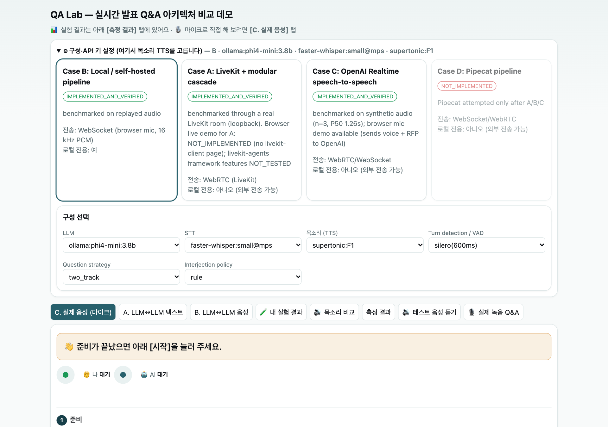
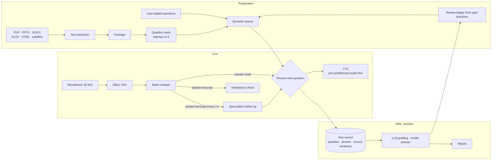
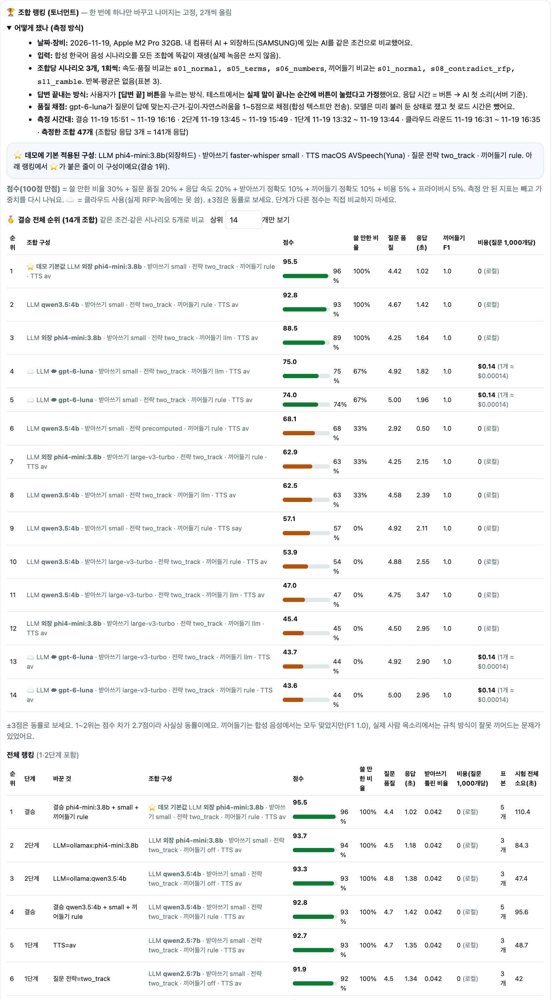
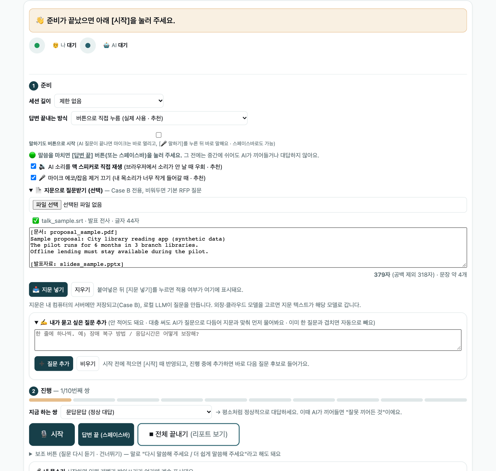
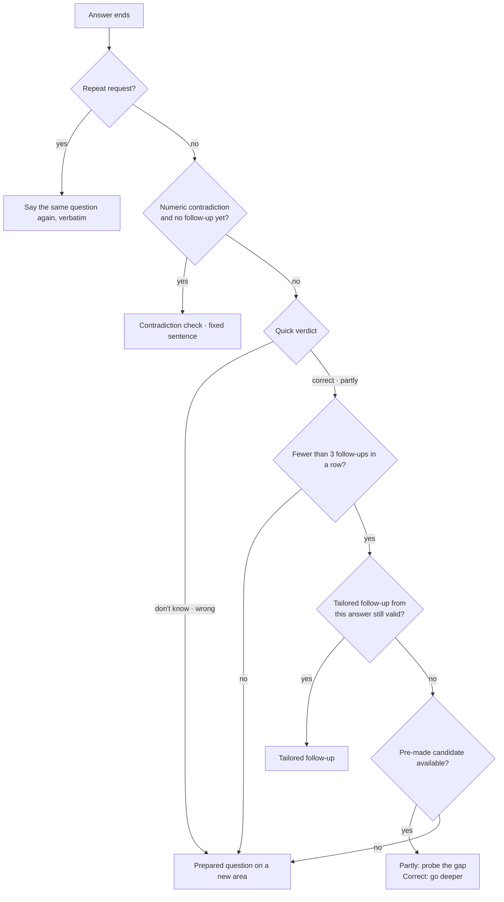
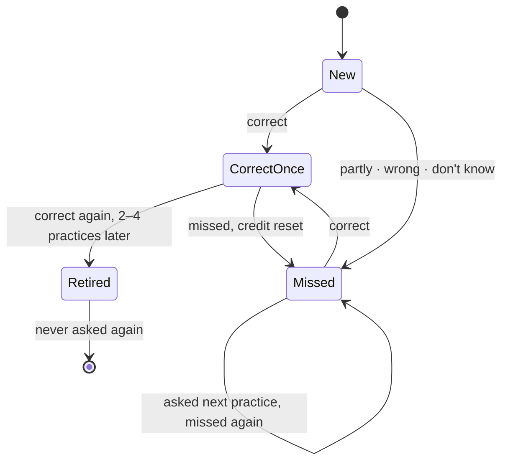

# Real-time Mock Interview

**English** · [한국어](README.ko.md)

An AI reviewer **asks questions aloud**, grounded in your proposal and slides. While you answer, it prepares **follow-up questions** and **interjects** when needed. After the practice it builds a **report** with a verdict, a model answer, and the source of each question. In the default setup, speech recognition, question generation, and speech synthesis all run **locally** on your machine.

The product speaks and displays **Korean**.



> **How to read this document**
> Each feature records *the problem, the options we considered, and what we decided and why*. The descriptions reflect **the behavior in the current code**. Most figures come from small-sample experiments, so please read them as indications rather than guarantees.

---

## Contents

1. [Design principles](#1-design-principles)
2. [Architecture](#2-architecture)
3. [Model and configuration selection](#3-model-and-configuration-selection)
4. [Material upload and text extraction](#4-material-upload-and-text-extraction)
5. [Opening question and question bank](#5-opening-question-and-question-bank)
6. [Question quality control](#6-question-quality-control)
7. [Question priority](#7-question-priority)
8. [Follow-up questions](#8-follow-up-questions)
9. [Interjections](#9-interjections)
10. [Answer turns and speech processing](#10-answer-turns-and-speech-processing)
11. [Repeat requests and user-added questions](#11-repeat-requests-and-user-added-questions)
12. [Session time limit](#12-session-time-limit)
13. [Report, grading, and source retrieval](#13-report-grading-and-source-retrieval)
14. [Cumulative review ledger](#14-cumulative-review-ledger)
15. [Latency and heat optimization](#15-latency-and-heat-optimization)
16. [Privacy and security](#16-privacy-and-security)
17. [Setup and run](#17-setup-and-run)
18. [Verification, limitations, and roadmap](#18-verification-limitations-and-roadmap)

---

## 1. Design principles

| Principle | Why it matters | How the code applies it |
|---|---|---|
| **Speed first** | A conversation holds only if the AI starts speaking within about 2 seconds of the answer ending. | The next question and its audio are prepared during the answer. Grading and model answers are kept off the live path. |
| **Grounded questions** | Questions must come from the user's own material. | Each question stores its source sentence. Generic questions are filtered out. |
| **One thing per question** | A double-barreled question is hard to answer and hard to grade. | Prompt rules are combined with form checks in code. |
| **Never ask twice** | Repetition ruins a practice session. | Questions, follow-ups, and interjections are compared with everything already asked. |
| **Local by default** | Proposals and voices are sensitive. | The default setup sends nothing out. Cloud models are strictly opt-in. |
| **Change one thing at a time** | Changing several values at once hides the cause. | Model selection used a tournament; latency work used single-variable experiments. |

---

## 2. Architecture



### Pipeline options ("Cases")

One question engine was connected to three transport and speech architectures.

| Case | Setup | P50 to first sound (3 synthetic clips) | Strength | Constraint |
|---|---|---|---|---|
| **B (chosen)** | VAD → faster-whisper → local LLM → local TTS | 2.00 s | Full control over questions; nothing leaves the machine | Depends on hardware |
| A | Same processing as B over LiveKit (WebRTC) | 2.14 s | Standard real-time transport | Loopback only; no browser client built |
| C | OpenAI Realtime speech-to-speech | 1.26 s | Fastest | The model writes its own questions; audio leaves the machine |
| D | Pipecat | not implemented | — | — |

These are early figures, taken before the tournament and the optimization work. **We chose B not because it was fastest, but for control over questions, source traceability, and privacy.** Later optimization cut B's latency substantially ([Section 15](#15-latency-and-heat-optimization)).

---

## 3. Model and configuration selection

### 3.1 Method: a tournament

Measuring every combination would mean hundreds of runs and a very hot laptop. We therefore **changed one axis at a time, held the rest at the current best, and advanced only the top two.**

| Round | Axis changed | Combinations measured |
|---|---|---|
| Stage 1 | STT, TTS, interjection policy, question strategy | 14 |
| Stage 2 | LLM (internal Ollama and external-drive models) | 14 |
| Final | Combinations of the top candidates | 14 |
| Cloud round | Cloud LLMs (separate lane) | 5 |

- **Hardware:** Apple M2 Pro, 32 GB (Metal GPU)
- **Input:** synthetic Korean speech, with identical files replayed to every combination. No real recordings were used, because cloud combinations were included.
- **Sample size:** 3–5 scenarios depending on the round, one run each

### 3.2 Scoring

`score = 100 × Σ(metric score × weight) ÷ Σ(weights of measured metrics)`

| Metric | Definition | Weight |
|---|---|---|
| Usable rate | Share of scenarios with first sound within 2.0 s **and** question quality ≥ 3.5/5 | 30% |
| Question quality | A judge model rates relevance, grounding, depth, and naturalness from 1 to 5 | 20% |
| Speed | `Answer done` press to first AI sound (full marks at ≤ 1 s, zero at ≥ 3 s) | 20% |
| Transcription accuracy | Character error rate (CER) | 10% |
| Interjection accuracy | F1 on labeled scenarios | 10% |
| Cost | Estimated cloud cost per 1,000 questions | 5% |
| Privacy | Whether audio or text leaves the machine | 5% |

"Usable rate" carries the largest weight so that a combination that is *only fast* or *only good* cannot win. For example, the `precomputed` strategy, which only reads prepared questions, was fastest at 0.5 s but ranked low because its quality was 2.9.

### 3.3 Final-round ranking



See the [full ranking of all 47 combinations](docs/images/ranking_full.png) and [docs/RANKING.md](docs/RANKING.md) (Korean). Treat differences within ±3 points as a tie.

> The ⭐ "demo default" note on that screen describes the setup **at the time of the tournament**. The default voice changed afterwards; the current defaults are in the table below.

### 3.4 Final configuration

| Component | Choice | Rationale |
|---|---|---|
| LLM | `phi4-mini:3.8b` (Ollama) | Won the final (95.5). Effectively tied with `qwen3.5:4b` (92.8) and faster (1.02 s vs 1.42 s). |
| STT | `faster-whisper small` (MPS) | `large-v3-turbo` was more accurate on real speech but met the 2-second target less often. |
| Question strategy | `two_track` | Light decisions live, deeper analysis in the background. Far faster than `direct` (4.7 s) and `hybrid` (4.5 s). |
| Interjection | `rule` | All three policies tied on F1 in synthetic tests; rules are fastest and need no LLM call. |
| TTS | `Supertonic 3`, Korean voice `F1` (ONNX, local) | The tournament used macOS AVSpeech. The default changed after comparing voices, and **the Supertonic setup was not re-scored in the tournament.** |
| VAD | Silero VAD (600 ms) | Used in automatic turn mode. |
| Turn mode | Button (`manual`) | See [Section 10](#10-answer-turns-and-speech-processing). |

> These are the defaults selected on the `/v2` page. If a WebSocket client omits them, the server falls back to `qwen2.5:7b` and `hybrid` interjection, so external clients should send the values explicitly.

### 3.5 Findings from supporting experiments

| Experiment | Result | Design impact |
|---|---|---|
| Transcribing 3 real-speech answers | CER: base 0.164, small 0.165, turbo 0.111 | Turbo has accuracy headroom; we chose speed. |
| Ending turns by silence length | One answer was split 3.7 times on average at 0.6 s; only 2.0 s gave a single end | The default is a button that ends the answer. |
| Transcription while an LLM runs | 0.53 s → 1.05 s on average | Background LLM work stops when an answer ends. |
| Judge reliability | Correlation with the reference judge: local 0.54–0.61, low-cost cloud 0.79 | Local scores are read as rough ordering, not absolute values. |

Methods and limitations: [docs/MINI_SUITE.md](docs/MINI_SUITE.md) (Korean).

---

## 4. Material upload and text extraction

Pitch coaching usually involves **(1) a proposal or RFP, (2) presentation slides, and (3) a speech transcript.** Upload any of them; the text is extracted and appended to the passage.

| Format | Handling |
|---|---|
| PDF | Read with `pypdf`; if little text is found, retried with `pdftotext` when installed |
| PPTX | Per-slide text, tables, grouped shapes, and speaker notes |
| DOCX · XLSX | Paragraphs and tables; rows per sheet |
| DOC · RTF | Converted with macOS `textutil` |
| HTML | Scripts and tags removed |
| SRT · VTT | Indices and timestamps removed; repeated captions kept once |
| JSON | Whisper-style `segments` joined |
| TXT · MD · CSV | Decoded as UTF-8, UTF-16, CP949, or EUC-KR |

- **Format detection:** the file's **byte signature** is checked before its name.
- **Unreadable files:** scanned PDFs and images (no OCR yet), legacy `.ppt`, and `.hwp` show guidance on how to re-save them.
- **Limits:** 60 MB per file, 150,000 characters per passage. Uploaded files are not stored.



*The files in this screenshot are synthetic samples.*

---

## 5. Opening question and question bank

### 5.1 Handling long passages

An early version used only the first 30,000 characters and searched evidence in a 14-sentence sample. Now:

- The limit is **150,000 characters**.
- **Every sentence** (up to 1,500) is used for evidence search, contradiction checks, and choosing the next topic. On a synthetic passage of 50,000 characters and 600 sentences, finding the evidence sentence took 1 ms.
- The full passage is never sent to the model; it receives **sentence-level** context only.
- Debris from pasted web pages (timestamps, category lists, table fragments, caption tags such as `[음악]` for music) is removed first.

### 5.2 The opening question

So that startup is not delayed, it is generated from **the opening lines only** (about 700 characters of complete sentences).

1. The question bank starts building in the background when the passage is entered. If it is ready, its first question (based on the opening lines) is used.
2. Otherwise, a single opening question is generated on the spot (up to two attempts).
3. If the model fails or returns a generic question, a grounded fallback names a concrete term from the opening and asks for its **evidence or figures**.

> **Why:** a question such as "Please explain the key point of this text in your own words" fits any document and is useless for proposal coaching. Such phrasing is blocked in four places: the prompt, the quality filter, the fallbacks, and the review ledger.

### 5.3 Question bank

| Setting | Value |
|---|---|
| Batch size | **3** |
| Refill trigger | **1 or fewer** unasked questions |
| Unit of generation | One model call per sentence (0.3–0.7 s) |
| Sentence selection | Golden-ratio stride, rotating across the beginning, middle, and end |
| Priority | Pauses while an answer is processed, yielding the model to the live path |

**Options considered**

| Approach | Per round | First round | CPU time for 14 questions |
|---|---|---|---|
| 14 questions plus model answers and follow-up candidates up front | about 43 LLM calls | significant heat | — |
| 7 at a time, refill at 2 left | 6.4–8.5 s | 8.5 s | about 15 s |
| **3 at a time, refill at 1 left (chosen)** | about 1.8 s | 1.9 s | about 8.4 s |

In those experiments one question lasted about 35 seconds, so a batch of 3 finished well ahead of need, and fewer questions were wasted. *These timings predate the stricter quality filters; afterwards a round sometimes took 5–8 seconds.*

---

## 6. Question quality control

A small local model does not follow every prompt rule, and adding more rules did not raise the pass rate. We therefore **keep generation light and filter in code.**

| Check | What it rejects |
|---|---|
| One thing only | Over 55 characters, yes/no comprehension checks, two joined subjects, two requests, two question marks, comma-linked double questions |
| Hard-to-read sentences | Stacked modifiers combined with possessive chains |
| Register | Blunt plain-form endings, or any ending that is not a polite question |
| Generic questions | "Key point", "in your own words", "this text" |
| Dangling references | "This sentence", "that picture": things the listener cannot see. If the referent is named, only the pointing word is removed. |
| Document debris | Dates and times, edit markers, video-title fragments, stray Chinese or Japanese characters |
| Grounding | Key terms must appear in the source sentence; a "why" question requires a stated reason in that sentence |
| Stutter | The same phrase repeated inside one question |
| Duplicates | Sentence similarity and key-term overlap against everything already asked |

Questions that fail only the strict grounding check are held in a **reserve** so the bank does not run dry. Reserve questions must still pass the *one thing only* check.

> **Remaining limitation:** filters block bad sentences but do not make the model write more fluent Korean. Stricter filters also leave fewer usable questions.

---

## 7. Question priority

The **priority score** shown in the UI and report is a value between 0 and 1 that decides *what to ask next*. It is neither a percentage nor an importance rating.

| Question type | Score | Intent |
|---|---|---|
| Opening question | `1.00` | Asked first |
| User-added | `0.99 − 0.001 × index` | Right after the opening |
| Review: answered wrong last time | `0.985 − 0.001 × index` | After user questions, before new ones |
| Question bank | `1.00 − 0.02 × generation index` | Asked in **generation order** |
| Review: answered right once | random in `0.3–0.9` | Mixed among new questions to avoid a memorized order |
| Generated on the spot (e.g. skip) | `0.4` | Used when nothing is prepared |

- At most 12 questions wait in the queue; the lowest-scored overflow is dropped.
- Questions retired after two correct answers are removed.
- Follow-ups do not wait in the queue; they attach directly to the answer just given.

> **To be explicit:** the current code **does not rank questions by assessed importance.** Bank order is generation order; coverage comes from spreading sentence selection across the passage. Importance-based ranking is on the [roadmap](#18-verification-limitations-and-roadmap).

---

## 8. Follow-up questions

### 8.1 Definition

> **A follow-up picks up something the person just said and goes one step further.** Re-asking the same question, or inventing content that is not in the material, is not a follow-up.

### 8.2 Choosing the next question



The **quick verdict** uses no LLM and only steers the next question.

- A short "I don't know" answer counts as `don't know`.
- Otherwise, 4 or more key terms shared with the relevant passage sentences means `correct`, 2 or more means `partly`, and fewer means `wrong`.

It is **not a grade.** Report verdicts are made separately by an LLM after the session ([Section 13](#13-report-grading-and-source-retrieval)).

> **Why:** drilling into an area the person got wrong or does not know produces a chain of unanswerable questions, so the engine moves on.

### 8.3 Tailored follow-ups, generated while you speak

Starting after the answer ends would exceed 2 seconds, so generation runs on **partial transcripts during the answer**.

**① Start conditions**
- The partial transcript has at least **15 characters.** (Originally 40; lowering it moved readiness from 10.2 s to 6.0 s.)
- A question-bank refill is not urgent.
- It is the first attempt, or at least 40 new characters have arrived since the last one.

**② Evidence search** — find a passage sentence such that:
- a word in the answer is **new**, meaning it is not in the question;
- that word is rare, appearing in **at most 2** passage sentences;
- the sentence has **not been used** for a follow-up before;
- the match is an English or numeric term, or at least 2 ordinary Korean words.

**No evidence sentence, no follow-up.**

**③ Type selection** — conditions are checked top-down, avoiding the previous type.

| Type | Condition |
|---|---|
| Elaborate | The part mentioning the new term is short |
| Verification | The passage sentence mentions measuring, verifying, or criteria, but the answer does not |
| Rationale | The passage sentence gives a reason or need, but the answer does not |
| Sequence | In a passage procedure of 3+ steps, the answer skipped a middle step or stopped early. Uses a fixed template with no LLM call. |
| Deeper | Last resort: evidence exists but no specific type applies |

**④ Acceptance checks**
- Korean, 8–110 characters, asking one thing
- Ends as a polite question
- Not similar to anything already asked
- Does not copy more than 60% of the answer
- **Contains a term newly introduced by the answer**

**⑤ Final check before use** — the final answer must retain at least 60% of the key terms present at generation time. Generation still running when the answer ends is cancelled, because a running LLM roughly doubles transcription time.

### 8.4 Pre-made candidates

Right after asking a question, the engine prepares a **"go deeper"** and a **"fill the gap"** candidate from the source sentence only. They are used when no tailored follow-up is ready.

### 8.5 Chain limit and bridge phrases

- At most **3 follow-ups in a row** per question. Sources we found typically suggest 1–3, but we found no established research standard, so this is a design choice.
- To avoid an abrupt turn, a short bridge acknowledges the answer and names the part being picked up. Later turns use a "one more thing" phrase.
- Bridge audio is pre-synthesized first.
- The follow-up's **source sentence is stored**; pre-made candidates inherit the parent's source.
- The report records, in one line, **why** a follow-up was or was not asked.

> **Measured:** in synthetic-answer tests, answer-based follow-ups passing the checks rose from 1 of 10 to 8–9 of 20 (40–45%), and median writing time fell from 1.2 s to 0.8 s. *These figures predate the latest tightening of the one-thing rule (such as the 55-character limit).*

---

## 9. Interjections

During an answer, the latest 14 seconds of partial transcript are checked **every 3 seconds**, starting 3 seconds into the answer.

| Situation | Default policy (`rule`) |
|---|---|
| A number that conflicts with the passage | Same unit and related words, but a value that violates the passage's condition |
| A number that conflicts with an earlier answer | Different value of the same unit with 3+ shared key terms |
| Repetition | Repeated three-word sequences exceed 30% |
| Off topic | After 8 s and over 60 characters, overlap with the question's key terms is below 20% |
| Overlong | More than 75 s |

- **Wording:** fixed sentences with a three-part shape (polite opener, short reason, hand back the floor). No LLM call; audio is pre-synthesized.
- **No repeats:** a sentence already used is never said again.
- **Re-arming:** after an interjection, only speech that follows it is judged.
- **Alternatives:** `llm` (model decides) and `hybrid` (rule triggers, model confirms).

**Behavior decisions:** unrelated talk is cut off and redirected. A vague answer is not interrupted; it gets a probing question instead. Judging general factual errors was left out because of cost and latency, so only **numeric contradictions** are detected.

> **Stated plainly:** these thresholds are **starting values**, not research-based. The off-topic length was lowered from 90 to 60 characters after calculating that a 14-second window holds only about 75–93 characters at a normal speaking rate. F1 was 1.0 on synthetic tests, but on real speech the rule policy often misread normal answers as off topic (7 of 9 runs in an early test). It has since been tuned on practice sessions, but **it still needs proper validation on real speech.**

---

## 10. Answer turns and speech processing

### 10.1 Detecting the end of an answer

| Option | Outcome |
|---|---|
| Silence length | Short values cut people off; long values delay the reply |
| Silence plus sentence endings | Worse than plain 0.6 s, since Korean sentence endings often occur mid-sentence |
| Speculative generation with 1.5 s confirmation (automatic mode) | Interruptions per answer fell from 2.7 to 1.3 |
| **Button press (chosen)** | The user signals the end, so they are not cut off mid-answer |

In button mode, speech before each pause is **transcribed ahead of time**, leaving only the tail after the press.

### 10.2 Controls

- Three core buttons: **Start, Answer done (Space), End session**.
- Replay and skip are secondary. Skip uses a prepared question immediately, or generates one within 4 s.
- **Push-to-talk** is available as an option.

### 10.3 Transcription robustness

| Problem | Fix |
|---|---|
| On noise, Whisper reads back the vocabulary hint | Hint rewritten as a sentence; leaked hint words stripped |
| Hallucinated sign-offs on silence, such as a news anchor line | Known phrases removed |
| Long runs of one repeated character | Removed |
| One-syllable answers such as "yes" were discarded | Genuine one-syllable answers are kept |
| Domain terms transcribed incorrectly | English terms from the passage are passed as hints |

### 10.4 Speech synthesis

- Predictable sentences (next question, follow-up candidates, interjections, bridges) are **synthesized in advance**.
- The first audio chunk is flushed early, at a comma or around 14 characters.
- So the Korean voice does not change accent on English words, they are converted to Korean pronunciation **only for speech**; on-screen text is unchanged.

---

## 11. Repeat requests and user-added questions

### 11.1 "Could you say that again?"

In a real evaluation you can ask the reviewer to repeat a question you did not catch.

| Request | Behavior |
|---|---|
| "Please repeat that", "too fast" | The same question is said again **unchanged** |
| "Say it more simply", "what do you mean?" | **Not simplified.** The same question is repeated verbatim. |

> **Why:** we first built LLM-based simplification, then removed it. A reviewer keeps the level of the question, and how well the person understood it shows in the graded answer. No hints are given.

- Detection is rule-based, with no LLM call. A long answer (60+ characters) that merely contains such words is treated as a real answer.
- Request turns are **not answers**, so they are never graded and are marked separately in the report.

### 11.2 Questions you want to be asked

- A keyword or half sentence is rewritten into **one question aligned with the passage** (up to 10).
- LLM rewriting happens only **when you add** the question. Starting a session or adding one mid-session uses no LLM, so it adds no latency.
- A keyword added mid-session is instantly turned into a request for the proposal's evidence on that topic.
- Duplicates of asked questions are dropped. If a similar question is waiting, it is promoted and marked as **yours**.
- The report shows that you added it, its priority score, and your original wording.

---

## 12. Session time limit

Choose **10, 20, or 30 minutes**, or no limit. The clock starts with the first question.

| When time runs out | Behavior |
|---|---|
| You are speaking | **Hears you out**, then closes |
| Your answer is being processed | Says the closing line instead of a new question |
| The AI is asking | Finishes the question and waits for your answer |
| 10 s of silence | Says the closing line |

The closing line is a natural Korean sign-off ("Okay, I've heard you up to here. Thank you for your presentation."). The report is generated automatically about 5 s later.

> Current limitation: the **last answer heard after time ran out appears in the on-screen transcript but is not counted in the report.** A full-length run with a real microphone has not been performed; the waiting and closing logic is covered by unit tests.

---

## 13. Report, grading, and source retrieval

### 13.1 Why grading is off the live path

An early version graded and wrote model answers during the session. Sharing one local model **slowed transcription and the next question, and increased heat.** Since results are reviewed after a mock interview anyway, all live grading was removed.

During the session only what grading needs is stored: the question, the transcript, which question each answer belongs to, **the question's source sentence**, and per-stage timings.

### 13.2 Source retrieval: remember instead of search

| Approach | Description |
|---|---|
| Keyword search | Find a similar passage sentence again at grading time |
| **Remembered source (chosen)** | Store the evidence sentence (up to 300 characters) **when the question is created** |

- On 6 answers there was no speed difference (1.68 s vs 1.55 s on average); output length dominated.
- We chose it for **accuracy**. Keyword search had picked an unrelated sentence as the reference and graded a correct answer as wrong.
- Bank questions keep the sentence they were generated from. Follow-ups keep **the sentence used for tailored generation, or the parent question's source**.
- If a question has no stored sentence (for example, one generated on the spot), the single sentence sharing the most key terms with the question is used. Only **one**, because a loosely related second sentence blurs the grading reference.
- Keyword search is the fallback only for old records without source data.

### 13.3 Grading

- **One** LLM call per answer returns the verdict (`correct`, `partly`, `wrong`), a one-sentence reason, and a model answer. If the output is malformed, only the model answer is requested again.
- "I don't know" is classified without an LLM.
- Grading runs **in the background after the session.** The report appears first and verdicts fill in one by one. Results are saved, so reopening costs nothing. Measured at 1.5–2.4 s per answer.
- The full passage is not sent: only the question, the answer (up to 600 characters), and the source sentence (up to 300).

> **Limitations:** verdicts are three labels, not scores. Because the reference is a short excerpt, answers spanning several sentences can be disadvantaged. Local-model grading agrees weakly with the reference judge and should be treated as advisory.

### 13.4 What the report contains

- Each question's **origin** (opening, passage-based, user-added, follow-up type and depth, interjection) and priority score
- Your answer, verdict and reason, and a model answer
- Why a follow-up did or did not happen
- Review history: which correct answer this is, and when it was missed
- Per-stage latency (transcription, question generation, synthesis), turns over 2 s, and what else was running then
- Interjection counts, false positives and induced catches, and estimated cost for cloud use
- A shareable Markdown summary

---

## 14. Cumulative review ledger

Across repeated practices on the same passage, **mastered questions fade out and missed ones come back.**



- Only `correct` counts. Only **LLM grading** is used, never the live quick verdict.
- Two correct answers retire a question; a miss in between resets the count.
- Up to 8 review questions per practice, missed ones first.
- Follow-ups, interjections, and repeat requests are not tracked.
- Stored questions and model answers are reused, so there is **no LLM call**.
- Generic questions saved in older records are not loaded.

**Storage options** (measured under the same conditions)

| Option | Read time |
|---|---|
| Re-reading 50 past reports | 16.4 ms |
| **One cumulative JSON file (chosen)** | 0.8 ms |
| SQLite | 0.22 ms |

All are negligible next to an LLM call measured in seconds, so we picked the simplest. The file is replaced atomically so an interruption cannot corrupt it. Retired-question checks compare source-sentence hashes (0.014 ms) rather than scanning for similarity (16 ms for 13 checks).

---

## 15. Latency and heat optimization

### 15.1 How latency was reduced

| Category | Technique |
|---|---|
| **Prepare ahead** | Question bank, follow-up candidates, tailored follow-ups during the answer, pre-synthesized audio |
| **Shorten the live path** | No grading or model answers live; rule-based quick verdict; fixed interjection sentences |
| **Manage contention** | Background LLM work and synthesis pause while an answer is processed |
| **Start fast** | Opening question from the first lines; models preloaded before start (`/api/prewarm`) |
| **Remove waiting** | Answer-done button, chunked transcription during pauses, immediate confirmation of a prepared reply |

### 15.2 Single-variable experiments and adoption rules

A speed change was adopted only if the *median fell by at least 8% and at least 0.05 s*. A heat change required *Whisper time to fall by at least 15% with the median rising no more than 0.05 s*. CPU time varied too much between runs to be used.

| Experiment | Result | Decision |
|---|---|---|
| Partial transcription every 2 s → 4 s | Whisper time −51%, same median latency | Adopted, then **set to 3 s** for interjection responsiveness |
| LLM context 4096 → 2048 | Gain smaller than baseline-to-baseline variance | Rejected |
| Transcription window 14 s → 8 s | Conflicts with the text length interjection rules need | Held |
| Follow-up start threshold 40 → 15 characters | Ready in 6.0 s instead of 10.2 s, same Whisper load | Adopted |
| First transcription at 3 s | Earlier readiness, but Whisper load +59% | Held |

Moving the interjection interval from 4 s to 3 s improves the average reaction from about 2.4 s to 1.9 s (calculated) and adds about 29% Whisper work per second of speech.

### 15.3 Results and how to read them

| Measure | Value | Conditions |
|---|---|---|
| Median, answer end → first sound | 0.47–0.56 s | 5 synthetic answers, measured at the server |
| Average in the first live-voice run | 2.25 s (max 5.53 s) | Single run before optimization |
| When nothing is prepared and a question is generated on the spot | about 2–4 s | Still open |

> **Honest reading:** the median applies *when prepared questions and audio are used*. Latency can exceed 2 s when the bank runs dry. Figures come from synthetic speech and small samples, and exclude browser playback time.

Details (Korean): [docs/LATENCY_AB.md](docs/LATENCY_AB.md), [docs/LIVE_RUN_LOG.md](docs/LIVE_RUN_LOG.md)

---

## 16. Privacy and security

- The default setup (Case B, Ollama, faster-whisper, Supertonic) **sends neither audio nor passage text off the machine.**
- Choosing Case C, an `openai:` LLM, or OpenAI STT/TTS **sends audio or text to OpenAI.** Use only public or synthetic material with these.
- In our experiments, cloud services received synthetic data only; real recordings stayed local.
- API keys are passed via environment variables.
- Practice records (`data/`), recordings, and model files are excluded from the repository. Local records contain **your transcripts and the full passage**, so share them carefully.
- The demo server binds to `127.0.0.1` and has **no authentication.** Do not expose it. Production would need per-session authentication, retention limits, and deletion. ([docs/SECURITY.md](docs/SECURITY.md))

---

## 17. Setup and run

Verified on Apple Silicon macOS with Python 3.12.

```bash
uv venv --python 3.12 .venv
```

```bash
uv pip install --python .venv/bin/python openai httpx pydantic fastapi "uvicorn[standard]" websockets numpy scipy pytest faster-whisper silero-vad torch soundfile supertonic pypdf python-pptx python-docx openpyxl python-multipart
```

```bash
ollama serve
```

```bash
ollama pull phi4-mini:3.8b
```

- **Voice model:** Supertonic 3 model files are not included. Place them in `models/tts/supertonic-3/` or set `SUPERTONIC_DIR`. To use the macOS voice (`macos-avspeech:Yuna`), also install `pyobjc-framework-AVFoundation`.
- **Environment variables:** `OLLAMA_URL` (default `http://localhost:11434`); `OPENAI_API_KEY` (only for cloud comparisons)

```bash
.venv/bin/python -m qa_lab serve --port 8765
```

Open <http://127.0.0.1:8765/v2>. The previous UI is at `/`.

```bash
.venv/bin/python -m pytest -q tests
```

### Troubleshooting

| Symptom | Check |
|---|---|
| Stuck on "generating question" | Ollama is running and the selected model is pulled |
| The first question never plays | Look for `ModuleNotFoundError` in the server log; the selected TTS needs its package and model files |
| No AI audio | Use the speaker test on the page, or enable playback through the Mac speakers |

### Layout

```text
qa_lab/
├── core/
│   ├── engine.py          next-question logic, follow-ups, quick verdict, grading
│   ├── passage.py         passage cleanup, opening question, question bank
│   ├── planner.py         prompts and question quality filters
│   ├── question_queue.py  priority queue and de-duplication
│   ├── interjection.py    interjection policies
│   ├── clarify.py         repeat-request detection
│   ├── user_questions.py  user question conversion and queuing
│   ├── ledger.py          cumulative review ledger
│   └── extract.py         file text extraction
├── cases/                 pipeline options (A, B, C) and voice runtime
├── providers/             VAD, STT, TTS
├── demo/                  FastAPI server and pages (/ and /v2)
├── benchmark/             tournament, latency experiments, scoring
└── simulator/             simulated presenter
tests/                     unit and integration tests
docs/                      experiment logs, rankings, integration spec, security
results/                   raw measurements (synthetic data)
```

### Documents

Most documents are in Korean.

| Document | Content |
|---|---|
| [RANKING.md](docs/RANKING.md) | Combination ranking and scoring metrics |
| [MINI_SUITE.md](docs/MINI_SUITE.md) | Focused comparison experiments |
| [LATENCY_AB.md](docs/LATENCY_AB.md) | Single-variable latency and heat experiments |
| [LIVE_RUN_LOG.md](docs/LIVE_RUN_LOG.md) | Issues found in live-voice runs and their fixes |
| [TOURNAMENT_PLAN.md](docs/TOURNAMENT_PLAN.md) | Tournament design |
| [INTEGRATION_API.md](docs/INTEGRATION_API.md) | Voice protocol for UI integration |
| [SECURITY.md](docs/SECURITY.md) | Security and privacy |

> Experiment documents record the state at the time of writing. Where they differ from this README, **the README and the current code are authoritative.**

---

## 18. Verification, limitations, and roadmap

### Verified
- Automated tests: queue, follow-ups, repeat requests, user questions, review ledger, manual turns, time limit, file extraction
- Model and configuration comparisons and latency experiments on synthetic speech
- File upload: extraction checked on synthetic samples, plus an in-browser upload

### Not yet sufficiently verified
- **A complete real-microphone practice** with the latest quality filters and the time limit
- Interjection accuracy across speakers and noisy environments
- Concurrent users. The server stores a single passage and a single set of user questions, so it assumes **one user**.

### Known limitations
- A small local model can produce awkward Korean questions.
- Multiple uploads are **concatenated into one passage**; the engine does not yet distinguish material types.
- No OCR, `.hwp`, or legacy `.ppt` support.

### Roadmap (design stage, not implemented)
1. **Cross-material questions:** compare the proposal, slides, and speech transcript, and ask about conflicting figures or claims and items left out of the talk.
2. **Reviewer personas:** role, evaluation concerns, and questioning intensity.
3. **Evidence scope:** *uploaded material only*, or *with external references*. External mode would cite sources, search at upload time to avoid live latency, and run as a separate mode whose search queries do not contain proposal text.
4. **Importance-based question priority.**
5. Calibrating interjection thresholds on real speech; per-session storage and authentication.

---

> This is an experimental research and learning project. Samples are small; read the numbers as the basis for design decisions, not as performance guarantees.
